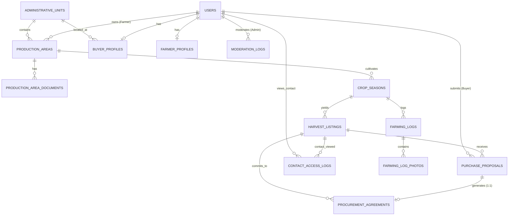

# 🗄️ Entity Relationship Diagram & Relational Schema Specification — MEKAGREEN

> **Trạng thái:** **DATABASE ERD V1: APPROVED & LOCKED**  
> **Căn cứ quyết định Product Owner:** PO-001, PO-002, PO-003, PO-004 (Phê duyệt ngày 14/10/2026)  
> **Tài liệu nguồn:** [BUSINESS_RULES.md](./BUSINESS_RULES.md), [DECISIONS.md](./DECISIONS.md) (ADR-004 đến ADR-010), [PRODUCT_PLAN.md](./PRODUCT_PLAN.md), [UI_LOCK.md](./UI_LOCK.md), [USER_FLOWS.md](./USER_FLOWS.md)  
> **Ràng buộc:** Bất biến sau khi khóa. Mọi thay đổi cấu trúc bảng sau phiên này phải có sự phê duyệt bằng văn bản của Product Owner.

---

## 1. Nguyên tắc Thiết kế & Kiến trúc CSDL

1. **Tuân thủ triệt để phạm vi MVP (Scope Guard):** Không tạo bảng thanh toán (payment), hóa đơn (invoice), vận chuyển (logistics/shipping) hay chữ ký số pháp lý (e-signature) theo đúng [ADR-004](./DECISIONS.md#L38) và [ADR-005](./DECISIONS.md#L48).
2. **Quy chuẩn Động cơ & Phiên bản CSDL:**
   - **Phiên bản yêu cầu:** Bắt buộc **MySQL >= 8.0.16** cho MVP để đảm bảo thực thi đầy đủ ràng buộc `CHECK` và cột sinh tự động `STORED GENERATED`.
   - **Engine:** `InnoDB` (bắt buộc để đảm bảo giao dịch ACID, khóa dòng bi quan `FOR UPDATE` và toàn vẹn khóa ngoại).
   - **Charset/Collation:** `utf8mb4` / `utf8mb4_0900_ai_ci` (hoặc `utf8mb4_unicode_ci`).
3. **Chiến lược Phòng thủ Chiều sâu (Defense-in-Depth):**
   - Ràng buộc toàn vẹn được khai báo ở mức CSDL (`CHECK`, `STORED GENERATED`, `FOREIGN KEY`, `UNIQUE`).
   - **Toàn bộ invariant nghiệp vụ, luật toán học sản lượng và điều kiện chuyển trạng thái bắt buộc phải được thẩm định và kiểm soát độc lập ở tầng ứng dụng (Laravel `ProcurementService` và `FormRequest`)** song song với ràng buộc CSDL.
4. **Thứ tự Khóa dòng Toàn cục (Fixed Lock Ordering):**
   - Mọi giao dịch chạm tới nhiều thực thể trong chuỗi thu mua bắt buộc khóa theo thứ tự cố định:
     $$\mathbf{harvest\_listings} \longrightarrow \mathbf{procurement\_agreements} \longrightarrow \mathbf{purchase\_proposals}$$
   - Không tuyên bố "loại trừ hoàn toàn deadlock"; hệ thống áp dụng cơ chế tự động thử lại giao dịch với số lần giới hạn: `DB::transaction(..., 3)`.
5. **Quy chuẩn Đơn vị & Dữ liệu:**
   - **Sản lượng:** Chuẩn hóa theo **Kilogram (`kg`)**, kiểu dữ liệu `DECIMAL(12, 2) UNSIGNED` để triệt tiêu sai số dấu phẩy động (`float`). (Ví dụ: 10 tấn = 10,000.00 kg).
   - **Mức giá & Điều khoản:** Giữ định dạng văn bản linh hoạt (`VARCHAR(100)`) cho MVP để phản ánh chính xác thực tế thương thảo nông sản (giá tham khảo, giá đề xuất, giá chốt). Bảo toàn snapshot điều khoản và mức giá giống hệt nhau khi hai bên xác nhận thỏa thuận. Bộ lọc theo giá số (numeric price filtering) tạm hoãn sau MVP.
   - **Tọa độ:** `DECIMAL(10, 7)` cho cả Vĩ độ (-90 đến 90) và Kinh độ (-180 đến 180).
   - **Diện tích:** `DECIMAL(8, 2) UNSIGNED` kết hợp đơn vị chuẩn `ha` hoặc `m2`.
6. **Tổng số bảng trong hệ thống:** Đúng **14 bảng chuẩn hóa**, phân loại thành 6 nhóm nghiệp vụ.

---

## 2. Sơ đồ Quan hệ Thực thể (Mermaid ERD — 14 Bảng)



---

## 3. Đặc tả Chi tiết 14 Bảng Dữ liệu

### Nhóm 1: Người dùng, Định danh & Hồ sơ (3 bảng)

#### 3.1. Bảng `users` (Tài khoản người dùng)
Quản trị tài khoản cho cả 3 vai trò. Tuân thủ quyết định **PO-001**: Số điện thoại là trường định danh bắt buộc duy nhất; Email là tùy chọn; không tuyên bố xác minh SĐT khi chưa có cổng SMS OTP thực tế. **Giới hạn khôi phục mật khẩu trong MVP:** Đối với tài khoản đăng ký chỉ bằng SĐT mà không có email hoặc OTP xác thực, tính năng tự khôi phục mật khẩu (automated password recovery) không khả dụng; hệ thống tuyệt đối không tự phát minh quy trình khôi phục thủ công chưa được kiểm chứng qua Admin.

| Tên cột | Kiểu dữ liệu | Ràng buộc | Mô tả |
| :--- | :--- | :--- | :--- |
| `id` | `BIGINT UNSIGNED` | `PK`, `AUTO_INCREMENT` | Định danh tài khoản |
| `phone` | `VARCHAR(20)` | `NOT NULL`, `UNIQUE` | Số điện thoại đăng nhập chính (bắt buộc theo PO-001) |
| `email` | `VARCHAR(150)` | `NULL`, `UNIQUE` | Email tùy chọn (có thể để trống, nếu có phải duy nhất) |
| `password` | `VARCHAR(255)` | `NOT NULL` | Hash mật khẩu (Bcrypt hoặc Argon2id) |
| `role` | `ENUM('FARMER', 'BUYER', 'ADMIN')` | `NOT NULL` | Vai trò hệ thống (BR-004) |
| `account_type` | `ENUM('INDIVIDUAL', 'COOPERATIVE')` | `NULL` | Dành riêng cho `FARMER` (ADR-007). `BUYER`/`ADMIN` là `NULL` |
| `full_name` | `VARCHAR(100)` | `NOT NULL` | Họ tên cá nhân hoặc tên người đại diện |
| `status` | `ENUM('ACTIVE', 'SUSPENDED', 'PENDING_REVIEW')` | `NOT NULL DEFAULT 'ACTIVE'` | Trạng thái hoạt động của tài khoản |
| `remember_token` | `VARCHAR(100)` | `NULL` | Token lưu phiên đăng nhập |
| `created_at` | `TIMESTAMP` | `NOT NULL DEFAULT CURRENT_TIMESTAMP` | Thời điểm tạo |
| `updated_at` | `TIMESTAMP` | `NOT NULL DEFAULT CURRENT_TIMESTAMP ON UPDATE CURRENT_TIMESTAMP` | Thời điểm cập nhật |

* **Indexes:** `idx_users_role_status (role, status)`, `idx_users_phone (phone)`.

---

#### 3.2. Bảng `farmer_profiles` (Hồ sơ Nhà vườn / Hợp tác xã)
Lưu thông tin liên hệ ngoại sàn (BR-035, BR-036). Được bảo vệ bởi phiên đăng nhập (BR-037).

| Tên cột | Kiểu dữ liệu | Ràng buộc | Mô tả |
| :--- | :--- | :--- | :--- |
| `id` | `BIGINT UNSIGNED` | `PK`, `AUTO_INCREMENT` | Khóa chính |
| `user_id` | `BIGINT UNSIGNED` | `NOT NULL`, `UNIQUE`, `FK -> users(id) ON DELETE RESTRICT` | Liên kết tài khoản Nông dân |
| `farm_name` | `VARCHAR(150)` | `NOT NULL` | Tên vườn / Hợp tác xã (vd: Nhà vườn Út Được) |
| `contact_person` | `VARCHAR(100)` | `NOT NULL` | Người phụ trách liên hệ |
| `phone_contact` | `VARCHAR(20)` | `NOT NULL` | SĐT gọi điện trực tiếp ngoài sàn |
| `zalo_phone` | `VARCHAR(20)` | `NULL` | SĐT Zalo để mở liên kết `https://zalo.me/...` |
| `facebook_url` | `VARCHAR(255)` | `NULL` | Trang cá nhân / Fanpage Facebook |
| `commune_code` | `VARCHAR(20)` | `NOT NULL`, `FK -> administrative_units(code) ON DELETE RESTRICT` | Đơn vị hành chính cấp xã/phường |
| `address_detail` | `VARCHAR(255)` | `NULL` | Địa chỉ cụ thể (thôn, ấp, số nhà) |
| `created_at` | `TIMESTAMP` | `NOT NULL DEFAULT CURRENT_TIMESTAMP` | |
| `updated_at` | `TIMESTAMP` | `NOT NULL DEFAULT CURRENT_TIMESTAMP ON UPDATE CURRENT_TIMESTAMP` | |

---

#### 3.3. Bảng `buyer_profiles` (Hồ sơ Bên mua / Thương nhân thu mua)
Lưu thông tin định danh bên mua theo chuẩn tối giản MVP (UI_LOCK 2.12 - T-20).

| Tên cột | Kiểu dữ liệu | Ràng buộc | Mô tả |
| :--- | :--- | :--- | :--- |
| `id` | `BIGINT UNSIGNED` | `PK`, `AUTO_INCREMENT` | Khóa chính |
| `user_id` | `BIGINT UNSIGNED` | `NOT NULL`, `UNIQUE`, `FK -> users(id) ON DELETE RESTRICT` | Liên kết tài khoản Bên mua |
| `company_name` | `VARCHAR(150)` | `NOT NULL` | Tên cơ sở kinh doanh / Vựa thu mua / Doanh nghiệp |
| `buyer_type` | `ENUM('TRADER', 'PURCHASING_COMPANY', 'WHOLESALER', 'PROCESSOR', 'EXPORTER', 'COOPERATIVE_BUYER', 'OTHER')` | `NOT NULL` | Phân loại bên mua (hồ sơ thương mại - BR-004a) |
| `commune_code` | `VARCHAR(20)` | `NOT NULL`, `FK -> administrative_units(code) ON DELETE RESTRICT` | Địa bàn hoạt động chính |
| `address_detail` | `VARCHAR(255)` | `NOT NULL` | Địa chỉ giao dịch bắt buộc |
| `tax_code` | `VARCHAR(30)` | `NULL` | Mã số thuế (Tùy chọn trong MVP) |
| `warehouse_info` | `TEXT` | `NULL` | Điểm tập kết / Kho lạnh bảo quản (Tùy chọn) |
| `target_crops` | `TEXT` | `NULL` | Danh mục nông sản quan tâm thu mua (Tùy chọn) |
| `created_at` | `TIMESTAMP` | `NOT NULL DEFAULT CURRENT_TIMESTAMP` | |
| `updated_at` | `TIMESTAMP` | `NOT NULL DEFAULT CURRENT_TIMESTAMP ON UPDATE CURRENT_TIMESTAMP` | |

---

### Nhóm 2: Địa giới Hành chính & Cơ sở Sản xuất (3 bảng)

#### 3.4. Bảng `administrative_units` (Đơn vị Hành chính 2 Cấp Nam Bộ 2026)
Hỗ trợ tìm kiếm, lọc theo 2 cấp: Tỉnh/TP $\rightarrow$ Xã/Phường và gán nhãn địa danh lịch sử (BR-031). Nếu chưa có tọa độ tâm xã, giữ `NULL` và không vẽ điểm giả (BR-033a).

| Tên cột | Kiểu dữ liệu | Ràng buộc | Mô tả |
| :--- | :--- | :--- | :--- |
| `code` | `VARCHAR(20)` | `PK` | Mã định danh chuẩn (vd: 'DT', 'DT_MDT') |
| `name` | `VARCHAR(100)` | `NOT NULL` | Tên chính thức (vd: 'Xã Mỹ Đức Tây') |
| `level` | `ENUM('PROVINCE', 'COMMUNE')` | `NOT NULL` | Cấp hành chính |
| `parent_code` | `VARCHAR(20)` | `NULL`, `FK -> administrative_units(code) ON DELETE RESTRICT` | Tỉnh trực thuộc nếu là cấp Xã |
| `historical_names` | `VARCHAR(255)` | `NULL` | Tên quen thuộc / địa danh lịch sử (vd: 'Cái Bè, Tiền Giang cũ') |
| `centroid_latitude` | `DECIMAL(10, 7)` | `NULL` | Vĩ độ tâm xã (để ghim vị trí gần đúng; để NULL nếu chưa có) |
| `centroid_longitude`| `DECIMAL(10, 7)` | `NULL` | Kinh độ tâm xã (để NULL nếu chưa có) |

* **Constraints:** `CONSTRAINT chk_admin_centroid_pair CHECK ((centroid_latitude IS NULL AND centroid_longitude IS NULL) OR (centroid_latitude BETWEEN -90 AND 90 AND centroid_longitude BETWEEN -180 AND 180))`
* **Indexes:** `idx_admin_parent (parent_code)`, `idx_admin_level (level)`.

---

#### 3.5. Bảng `production_areas` (Vùng sản xuất / Vườn trồng)
Đại diện vườn trồng thực tế. Tọa độ điểm thủ công (ADR-006) và cờ bảo mật GPS (ADR-009, BR-033b). Phân biệt rõ mã tự khai báo và Mã số vùng trồng (MSVT) chính thức (BR-060).

| Tên cột | Kiểu dữ liệu | Ràng buộc | Mô tả |
| :--- | :--- | :--- | :--- |
| `id` | `BIGINT UNSIGNED` | `PK`, `AUTO_INCREMENT` | Khóa chính |
| `farmer_id` | `BIGINT UNSIGNED` | `NOT NULL`, `FK -> users(id) ON DELETE RESTRICT` | Nông dân sở hữu (không xóa tầng khi đã có dữ liệu) |
| `commune_code` | `VARCHAR(20)` | `NOT NULL`, `FK -> administrative_units(code) ON DELETE RESTRICT` | Thuộc xã/phường |
| `name` | `VARCHAR(150)` | `NOT NULL` | Tên gọi vùng trồng (vd: Vườn sầu riêng Mỹ Đức Tây) |
| `internal_code` | `VARCHAR(50)` | `NULL` | Mã định danh nội bộ do nhà vườn tự đặt (vd: MDT-SR-01) |
| `certified_area_code`| `VARCHAR(50)`| `NULL` | **Mã số vùng trồng (MSVT)** do cơ quan chức năng cấp (nếu có) |
| `area_value` | `DECIMAL(8, 2) UNSIGNED` | `NOT NULL` | Diện tích tự khai báo |
| `area_unit` | `ENUM('ha', 'm2')` | `NOT NULL DEFAULT 'ha'` | Đơn vị diện tích chuẩn |
| `exact_latitude` | `DECIMAL(10, 7)` | `NULL` | Tọa độ GPS chính xác (Nông dân chấm trên bản đồ) |
| `exact_longitude` | `DECIMAL(10, 7)` | `NULL` | Tọa độ GPS chính xác |
| `is_gps_public` | `TINYINT(1)` | `NOT NULL DEFAULT 0` | **0 = Bảo mật mặc định, 1 = Công khai (ADR-009)** |
| `farming_standard` | `VARCHAR(150)` | `NULL` | Tiêu chuẩn canh tác tự khai báo (vd: VietGAP nội bộ) |
| `status` | `ENUM('ACTIVE', 'INACTIVE')` | `NOT NULL DEFAULT 'ACTIVE'` | Trạng thái vùng trồng |
| `created_at` | `TIMESTAMP` | `NOT NULL DEFAULT CURRENT_TIMESTAMP` | |
| `updated_at` | `TIMESTAMP` | `NOT NULL DEFAULT CURRENT_TIMESTAMP ON UPDATE CURRENT_TIMESTAMP` | |

* **Constraints:** `CONSTRAINT chk_prod_area_gps_pair CHECK ((exact_latitude IS NULL AND exact_longitude IS NULL) OR (exact_latitude BETWEEN -90 AND 90 AND exact_longitude BETWEEN -180 AND 180))`
* **Indexes:** `idx_prod_areas_farmer (farmer_id)`, `idx_prod_areas_commune (commune_code)`.

---

#### 3.6. Bảng `production_area_documents` (Giấy tờ chứng nhận đính kèm)
Lưu tài liệu do nhà vườn tải lên phục vụ Quản trị viên rà soát (BR-060, UI_LOCK 2.11).

| Tên cột | Kiểu dữ liệu | Ràng buộc | Mô tả |
| :--- | :--- | :--- | :--- |
| `id` | `BIGINT UNSIGNED` | `PK`, `AUTO_INCREMENT` | Khóa chính |
| `production_area_id`| `BIGINT UNSIGNED` | `NOT NULL`, `FK -> production_areas(id) ON DELETE CASCADE` | Thuộc vùng sản xuất nào |
| `document_name` | `VARCHAR(150)` | `NOT NULL` | Tên loại văn bản / chứng nhận |
| `file_path` | `VARCHAR(255)` | `NOT NULL` | Đường dẫn file lưu trữ riêng tư (Private Disk) |
| `review_status` | `ENUM('PENDING', 'REVIEWED', 'REJECTED')` | `NOT NULL DEFAULT 'PENDING'` | Trạng thái rà soát của Admin |
| `reviewer_note` | `VARCHAR(255)` | `NULL` | Ghi chú của quản trị viên |
| `reviewed_by` | `BIGINT UNSIGNED` | `NULL`, `FK -> users(id) ON DELETE SET NULL` | Quản trị viên xử lý |
| `reviewed_at` | `TIMESTAMP` | `NULL` | Thời điểm rà soát |
| `created_at` | `TIMESTAMP` | `NOT NULL DEFAULT CURRENT_TIMESTAMP` | |

---

### Nhóm 3: Mùa vụ & Nhật ký Canh tác (3 bảng)

#### 3.7. Bảng `crop_seasons` (Mùa vụ canh tác)
Mỗi đợt chăm sóc cây trồng gắn liền với một vùng sản xuất (T-11). **Lưu trữ gốc của nông sản (`crop_name`) và giống (`variety`)**.

| Tên cột | Kiểu dữ liệu | Ràng buộc | Mô tả |
| :--- | :--- | :--- | :--- |
| `id` | `BIGINT UNSIGNED` | `PK`, `AUTO_INCREMENT` | Khóa chính |
| `production_area_id`| `BIGINT UNSIGNED` | `NOT NULL`, `FK -> production_areas(id) ON DELETE RESTRICT` | Thuộc vùng trồng nào |
| `season_name` | `VARCHAR(100)` | `NOT NULL` | Tên vụ mùa (vd: Vụ mùa 2026, Vụ nghịch 2026) |
| `crop_name` | `VARCHAR(100)` | `NOT NULL` | Tên loại nông sản gốc (vd: Sầu riêng, Bưởi da xanh) |
| `variety` | `VARCHAR(100)` | `NOT NULL` | Giống nông sản gốc (vd: Ri6 cơm vàng hạt lép) |
| `category` | `VARCHAR(50)` | `NOT NULL` | Phân loại ngành hàng (Trái cây, Cây có múi,...) |
| `start_date` | `DATE` | `NOT NULL` | Ngày bắt đầu vụ mùa |
| `expected_harvest_start` | `DATE` | `NOT NULL` | Thời gian bắt đầu thu hoạch dự kiến |
| `expected_harvest_end` | `DATE` | `NOT NULL` | Thời gian kết thúc thu hoạch dự kiến |
| `status` | `ENUM('PLANNING', 'ACTIVE', 'HARVESTING', 'COMPLETED', 'CANCELLED')` | `NOT NULL DEFAULT 'ACTIVE'` | Trạng thái mùa vụ |
| `created_at` | `TIMESTAMP` | `NOT NULL DEFAULT CURRENT_TIMESTAMP` | |
| `updated_at` | `TIMESTAMP` | `NOT NULL DEFAULT CURRENT_TIMESTAMP ON UPDATE CURRENT_TIMESTAMP` | |

* **Constraints:** `CONSTRAINT chk_season_dates CHECK (expected_harvest_start >= start_date AND expected_harvest_end >= expected_harvest_start)`
* **Indexes:** `idx_seasons_prod_area (production_area_id)`, `idx_seasons_harvest_window (expected_harvest_start, expected_harvest_end)`.

---

#### 3.8. Bảng `farming_logs` (Nhật ký canh tác định kỳ)
Hành trình canh tác thực tế với 6 chip chuẩn hóa (UI_LOCK 2.6 - T-12, T-13).

| Tên cột | Kiểu dữ liệu | Ràng buộc | Mô tả |
| :--- | :--- | :--- | :--- |
| `id` | `BIGINT UNSIGNED` | `PK`, `AUTO_INCREMENT` | Khóa chính |
| `crop_season_id` | `BIGINT UNSIGNED` | `NOT NULL`, `FK -> crop_seasons(id) ON DELETE CASCADE` | Thuộc mùa vụ nào |
| `log_date` | `DATE` | `NOT NULL` | Ngày thực hiện |
| `activity_type` | `ENUM('WATERING', 'FERTILIZING', 'PEST_CONTROL', 'WEEDING', 'HARVESTING', 'OTHER')` | `NOT NULL` | 6 chip nhật ký nhanh chuẩn hóa |
| `title` | `VARCHAR(150)` | `NOT NULL` | Tiêu đề công việc |
| `description` | `TEXT` | `NOT NULL` | Nội dung mô tả chi tiết công việc thực hiện |
| `created_at` | `TIMESTAMP` | `NOT NULL DEFAULT CURRENT_TIMESTAMP` | |

* **Indexes:** `idx_farming_logs_season_date (crop_season_id, log_date DESC)`.

---

#### 3.9. Bảng `farming_log_photos` (Hình ảnh minh chứng thực tế)
Lưu hình ảnh thực tế đính kèm nhật ký. Bắt buộc xóa siêu dữ liệu EXIF GPS khi tải lên.

| Tên cột | Kiểu dữ liệu | Ràng buộc | Mô tả |
| :--- | :--- | :--- | :--- |
| `id` | `BIGINT UNSIGNED` | `PK`, `AUTO_INCREMENT` | Khóa chính |
| `farming_log_id` | `BIGINT UNSIGNED` | `NOT NULL`, `FK -> farming_logs(id) ON DELETE CASCADE` | Thuộc dòng nhật ký nào |
| `photo_url` | `VARCHAR(255)` | `NOT NULL` | Đường dẫn ảnh công khai trên Storage |
| `caption` | `VARCHAR(150)` | `NULL` | Chú thích ảnh |
| `sort_order` | `SMALLINT UNSIGNED` | `NOT NULL DEFAULT 0` | Thứ tự hiển thị |

---

### Nhóm 4: Nguồn cung Thu hoạch & Phân bổ Sản lượng (1 bảng)

#### 3.10. Bảng `harvest_listings` (Bài đăng nguồn cung thu hoạch)
Thực thể trung tâm. Quản trị phân bổ 4 đại lượng sản lượng bất biến (BR-050 đến BR-053). Tuân thủ quyết định **PO-002** (`moderation_status` độc lập), **PO-003** (chặn đóng bài khi còn thỏa thuận chờ), **PO-004** (`trace_code` duy nhất).

| Tên cột | Kiểu dữ liệu | Ràng buộc | Mô tả |
| :--- | :--- | :--- | :--- |
| `id` | `BIGINT UNSIGNED` | `PK`, `AUTO_INCREMENT` | Khóa chính |
| `code` | `VARCHAR(30)` | `NOT NULL`, `UNIQUE` | Mã bài đăng thân thiện (vd: 'HL-2026-001') |
| `crop_season_id` | `BIGINT UNSIGNED` | `NOT NULL`, `FK -> crop_seasons(id) ON DELETE RESTRICT` | Nguồn gốc mùa vụ |
| `farmer_id` | `BIGINT UNSIGNED` | `NOT NULL`, `FK -> users(id) ON DELETE RESTRICT` | Chủ sở hữu nguồn cung |
| `expected_quantity_kg` | `DECIMAL(12, 2) UNSIGNED` | `NOT NULL` | **`expectedQuantity`**: Tổng sản lượng dự kiến (kg) |
| `committed_quantity_kg`| `DECIMAL(12, 2) UNSIGNED` | `NOT NULL DEFAULT 0.00` | **`committedQuantity`**: Đã chốt `CONFIRMED` (kg) |
| `reserved_quantity_kg` | `DECIMAL(12, 2) UNSIGNED` | `NOT NULL DEFAULT 0.00` | **`reservedQuantity`**: Đang giữ chỗ `PENDING_CONFIRMATION` (kg) |
| `available_quantity_kg`| `DECIMAL(12, 2)` | `AS (expected_quantity_kg - committed_quantity_kg - reserved_quantity_kg) STORED` | **`availableQuantity`**: Cột sinh tự động |
| `expected_harvest_date`| `DATE` | `NOT NULL` | Ngày thu hoạch dự kiến |
| `harvest_window_days` | `SMALLINT UNSIGNED` | `NOT NULL DEFAULT 5` | Khung thu hoạch (+/- ngày) |
| `packaging_spec` | `VARCHAR(255)` | `NOT NULL` | Quy cách đóng gói (vd: Thùng carton 18kg) |
| `reference_price` | `VARCHAR(100)` | `NULL` | Giá tham khảo (để trống $\rightarrow$ hiện "Liên hệ / Thỏa thuận") |
| `status` | `ENUM('AVAILABLE', 'PARTIALLY_COMMITTED', 'FULLY_COMMITTED', 'CLOSED', 'CANCELLED')` | `NOT NULL DEFAULT 'AVAILABLE'` | **Đúng 5 trạng thái Database chuẩn (BR-053)** |
| `moderation_status` | `ENUM('APPROVED', 'FLAGGED', 'HIDDEN')` | `NOT NULL DEFAULT 'APPROVED'` | **Trạng thái kiểm duyệt độc lập (PO-002)** |
| `trace_code` | `VARCHAR(32)` | `NOT NULL`, `UNIQUE` | **Mã QR ngẫu nhiên không tuần tự (PO-004)** |
| `published_at` | `TIMESTAMP` | `NULL` | Thời điểm công khai bài đăng |
| `created_at` | `TIMESTAMP` | `NOT NULL DEFAULT CURRENT_TIMESTAMP` | |
| `updated_at` | `TIMESTAMP` | `NOT NULL DEFAULT CURRENT_TIMESTAMP ON UPDATE CURRENT_TIMESTAMP` | |

* **Constraints:**
  - `CONSTRAINT chk_listing_quantity_ceiling CHECK ((committed_quantity_kg + reserved_quantity_kg) <= expected_quantity_kg)`
  - `CONSTRAINT chk_listing_available_non_negative CHECK (available_quantity_kg >= 0.00)`
* **Indexes:**
  - `idx_listings_market (status, moderation_status, expected_harvest_date)`: Tìm kiếm, lọc trên Chợ.
  - `idx_listings_farmer (farmer_id, status)`: Dashboard Nhà vườn.
  - `idx_listings_trace (trace_code)`: Tra cứu QR tức thì trên trang T-04.

---

### Nhóm 5: Đề nghị Thu mua & Thỏa thuận Cam kết (2 bảng)

#### 3.11. Bảng `purchase_proposals` (Đề nghị thu mua từ Bên mua)
Bên mua gửi chào mua đến một bài đăng còn khả dụng (BR-040 đến BR-043a).

| Tên cột | Kiểu dữ liệu | Ràng buộc | Mô tả |
| :--- | :--- | :--- | :--- |
| `id` | `BIGINT UNSIGNED` | `PK`, `AUTO_INCREMENT` | Khóa chính |
| `listing_id` | `BIGINT UNSIGNED` | `NOT NULL`, `FK -> harvest_listings(id) ON DELETE RESTRICT` | Bài đăng nhận đề nghị |
| `buyer_id` | `BIGINT UNSIGNED` | `NOT NULL`, `FK -> users(id) ON DELETE RESTRICT` | Bên mua gửi đề nghị |
| `farmer_id` | `BIGINT UNSIGNED` | `NOT NULL`, `FK -> users(id) ON DELETE RESTRICT` | Nông dân nhận đề nghị |
| `proposed_quantity_kg` | `DECIMAL(12, 2) UNSIGNED` | `NOT NULL` | Sản lượng đề xuất (kg) |
| `proposed_price` | `VARCHAR(100)` | `NOT NULL` | Mức giá mong muốn đề xuất (vd: "75.000 đ/kg") |
| `pickup_date` | `DATE` | `NOT NULL` | Ngày dự kiến thu gom |
| `pickup_method` | `ENUM('AT_FARM', 'AT_COLLECTION_POINT')` | `NOT NULL DEFAULT 'AT_FARM'` | Phương thức giao nhận hàng |
| `note` | `TEXT` | `NULL` | Ghi chú thu mua riêng |
| `status` | `ENUM('PENDING', 'ACCEPTED', 'REJECTED', 'WITHDRAWN', 'EXPIRED')` | `NOT NULL DEFAULT 'PENDING'` | Trạng thái đề nghị (BR-043) |
| `expired_reason` | `VARCHAR(255)` | `NULL` | Lý do hết hạn theo Quy tắc 3A |
| `responded_at` | `TIMESTAMP` | `NULL` | Thời điểm Nông dân phản hồi |
| `created_at` | `TIMESTAMP` | `NOT NULL DEFAULT CURRENT_TIMESTAMP` | |
| `updated_at` | `TIMESTAMP` | `NOT NULL DEFAULT CURRENT_TIMESTAMP ON UPDATE CURRENT_TIMESTAMP` | |

* **Constraints:**
  - `CONSTRAINT chk_proposal_qty_positive CHECK (proposed_quantity_kg > 0.00)`
  - `CONSTRAINT chk_proposal_buyer_not_farmer CHECK (buyer_id != farmer_id)` (BR-040: Nông dân không gửi đề nghị cho chính mình).
* **Indexes:**
  - `idx_proposals_listing_status (listing_id, status)`
  - `idx_proposals_buyer (buyer_id, status)`
  - `idx_proposals_farmer (farmer_id, status)`

---

#### 3.12. Bảng `procurement_agreements` (Thỏa thuận thu mua hai bên xác nhận)
Biên bản cam kết song phương trên sàn. Đóng băng các điều khoản bất biến (ADR-005, ADR-008, BR-044 đến BR-048).

| Tên cột | Kiểu dữ liệu | Ràng buộc | Mô tả |
| :--- | :--- | :--- | :--- |
| `id` | `BIGINT UNSIGNED` | `PK`, `AUTO_INCREMENT` | Khóa chính |
| `code` | `VARCHAR(30)` | `NOT NULL`, `UNIQUE` | Mã thỏa thuận (vd: 'AGR-2026-001') |
| `proposal_id` | `BIGINT UNSIGNED` | `NOT NULL`, `UNIQUE`, `FK -> purchase_proposals(id) ON DELETE RESTRICT` | **Quan hệ 1:1 duy nhất với đề nghị chấp thuận** |
| `listing_id` | `BIGINT UNSIGNED` | `NOT NULL`, `FK -> harvest_listings(id) ON DELETE RESTRICT` | Bài đăng gốc |
| `farmer_id` | `BIGINT UNSIGNED` | `NOT NULL`, `FK -> users(id) ON DELETE RESTRICT` | Nông dân cam kết |
| `buyer_id` | `BIGINT UNSIGNED` | `NOT NULL`, `FK -> users(id) ON DELETE RESTRICT` | Bên mua cam kết |
| **SNAPSHOT ĐIỀU KHOẢN ĐÓNG BĂNG** | | | **Bất biến từ đề nghị được chấp nhận** |
| `agreed_crop_name` | `VARCHAR(100)` | `NOT NULL` | Tên nông sản tại thời điểm chốt |
| `agreed_variety` | `VARCHAR(100)` | `NOT NULL` | Giống chi tiết tại thời điểm chốt |
| `agreed_quantity_kg` | `DECIMAL(12, 2) UNSIGNED` | `NOT NULL` | Sản lượng chốt cam kết (kg) |
| `agreed_price` | `VARCHAR(100)` | `NOT NULL` | Mức giá chốt cam kết (chuỗi hiển thị đầy đủ) |
| `agreed_pickup_date` | `DATE` | `NOT NULL` | Ngày giao nhận đã chốt |
| `agreed_pickup_method`| `VARCHAR(50)` | `NOT NULL` | Phương thức giao nhận đã chốt |
| `agreed_packaging` | `VARCHAR(255)` | `NOT NULL` | Quy cách đóng gói chốt |
| `agreed_notes` | `TEXT` | `NULL` | Điều khoản ghi chú kèm theo |
| **DẤU VẾT XÁC NHẬN HAI BÊN** | | | **Quy tắc 2A: Độc lập xác nhận** |
| `farmer_confirmed_at`| `TIMESTAMP` | `NULL` | Dấu thời gian Nông dân bấm [Xác nhận thỏa thuận] |
| `buyer_confirmed_at` | `TIMESTAMP` | `NULL` | Dấu thời gian Bên mua bấm [Xác nhận thỏa thuận] |
| `confirmed_at` | `TIMESTAMP` | `NULL` | Thời điểm CẢ HAI BÊN hoàn tất xác nhận (`CONFIRMED`) |
| **TRẠNG THÁI & LỊCH SỬ HỦY BỎ**| | | **Quy tắc hủy PENDING_CONFIRMATION (ADR-008)** |
| `status` | `ENUM('PENDING_CONFIRMATION', 'CONFIRMED', 'CANCELLED')` | `NOT NULL DEFAULT 'PENDING_CONFIRMATION'` | Trạng thái thỏa thuận (BR-046) |
| `cancelled_by` | `ENUM('FARMER', 'BUYER', 'SYSTEM')` | `NULL` | Bên thực hiện hủy |
| `cancelled_by_user_id`| `BIGINT UNSIGNED` | `NULL`, `FK -> users(id) ON DELETE RESTRICT` | Tài khoản thao tác hủy |
| `cancellation_reason` | `VARCHAR(150)` | `NULL` | Lý do bắt buộc chọn từ danh mục chuẩn |
| `cancellation_note` | `TEXT` | `NULL` | Ghi chú thêm tùy chọn |
| `cancelled_at` | `TIMESTAMP` | `NULL` | Thời điểm hủy thỏa thuận |
| `created_at` | `TIMESTAMP` | `NOT NULL DEFAULT CURRENT_TIMESTAMP` | Thời điểm tạo thỏa thuận |
| `updated_at` | `TIMESTAMP` | `NOT NULL DEFAULT CURRENT_TIMESTAMP ON UPDATE CURRENT_TIMESTAMP` | |

* **Constraints:**
  - `CONSTRAINT chk_agreement_confirmed_state CHECK ((status = 'CONFIRMED' AND farmer_confirmed_at IS NOT NULL AND buyer_confirmed_at IS NOT NULL AND confirmed_at IS NOT NULL) OR (status != 'CONFIRMED'))`
* **Indexes:**
  - `idx_agreements_listing_status (listing_id, status)`
  - `idx_agreements_farmer_status (farmer_id, status)`
  - `idx_agreements_buyer_status (buyer_id, status)`

---

### Nhóm 6: Nhật ký Truy cập & Kiểm duyệt Vận hành (2 bảng)

#### 3.13. Bảng `contact_access_logs` (Nhật ký mở khóa thông tin liên hệ - BR-039)
Lưu vết tài khoản Bên mua (`BUYER`) đã mở xem SĐT/Zalo của nhà vườn (BR-037, BR-039). **Quy tắc phân quyền:** Chỉ tài khoản `BUYER` đã đăng nhập mới có quyền mở xem thông tin liên hệ nhà vườn trên bài đăng của người khác (không bắt buộc phải có đề nghị thu mua trước). Chủ sở hữu bài đăng (`Owner`) luôn xem được thông tin của chính mình mà không cần ghi log. Khách vãng lai và Public API tuyệt đối không tiếp cận được thông tin liên hệ này.

| Tên cột | Kiểu dữ liệu | Ràng buộc | Mô tả |
| :--- | :--- | :--- | :--- |
| `id` | `BIGINT UNSIGNED` | `PK`, `AUTO_INCREMENT` | Khóa chính |
| `user_id` | `BIGINT UNSIGNED` | `NOT NULL`, `FK -> users(id) ON DELETE CASCADE` | Tài khoản Bên mua (`BUYER`) đã đăng nhập |
| `harvest_listing_id` | `BIGINT UNSIGNED` | `NOT NULL`, `FK -> harvest_listings(id) ON DELETE CASCADE` | Bài đăng được mở liên hệ |
| `contact_type` | `ENUM('PHONE', 'ZALO', 'FACEBOOK')` | `NOT NULL` | Kênh liên hệ được mở |
| `ip_address` | `VARCHAR(45)` | `NULL` | Địa chỉ IP người xem |
| `accessed_at` | `TIMESTAMP` | `NOT NULL DEFAULT CURRENT_TIMESTAMP` | Thời điểm bấm xem |

* **Indexes:** `idx_contact_logs_user_listing (user_id, harvest_listing_id)`, `idx_contact_logs_listing (harvest_listing_id)`.

---

#### 3.14. Bảng `moderation_logs` (Lịch sử thao tác kiểm duyệt của Admin - UI_LOCK 2.12)
Lưu dấu vết các hành động ẩn/khôi phục bài đăng hoặc rà soát hồ sơ của Quản trị viên (PO-002).

| Tên cột | Kiểu dữ liệu | Ràng buộc | Mô tả |
| :--- | :--- | :--- | :--- |
| `id` | `BIGINT UNSIGNED` | `PK`, `AUTO_INCREMENT` | Khóa chính |
| `admin_id` | `BIGINT UNSIGNED` | `NOT NULL`, `FK -> users(id) ON DELETE RESTRICT` | Quản trị viên thao tác |
| `target_type` | `ENUM('HARVEST_LISTING', 'PRODUCTION_AREA', 'USER')` | `NOT NULL` | Loại thực thể xử lý |
| `target_id` | `BIGINT UNSIGNED` | `NOT NULL` | Khóa chính thực thể |
| `action` | `ENUM('HIDE', 'RESTORE', 'FLAG', 'APPROVE_DOC', 'REJECT_DOC', 'SUSPEND_USER')` | `NOT NULL` | Hành động thực hiện |
| `reason` | `VARCHAR(255)` | `NOT NULL` | Lý do kiểm duyệt bắt buộc |
| `created_at` | `TIMESTAMP` | `NOT NULL DEFAULT CURRENT_TIMESTAMP` | Thời điểm thực hiện |

* **Indexes:** `idx_moderation_target (target_type, target_id)`.

---

## 4. Nghiệp vụ Chuyên sâu & Giải thuật Cơ sở Dữ liệu

### 4.1. Toán học Sản lượng & Ràng buộc Chuyển trạng thái
- **Công thức:** $\text{availableQuantity} = \text{expectedQuantity} - \text{committedQuantity} - \text{reservedQuantity}$.
- **Trạng thái Database & Trạng thái Phái sinh UX (BR-053):**
  - Khi $\text{committed} = 0$ và $\text{reserved} = 0 \longrightarrow \text{DB status} = \text{'AVAILABLE'}$, UX hiển thị `[ 🟢 CÒN NGUỒN CUNG ]`.
  - Khi $0 < \text{committed} < \text{expected}$ và $\text{available} > 0 \longrightarrow \text{DB status} = \text{'PARTIALLY_COMMITTED'}$, UX hiển thị `[ 🔵 CÒN MỘT PHẦN ]`.
  - Khi $\text{committed} = \text{expected} \longrightarrow \text{DB status} = \text{'FULLY_COMMITTED'}$, UX hiển thị `[ 🟠 ĐÃ CHỐT TOÀN BỘ ]`.
  - **Trường hợp giữ chỗ hết sản lượng:** Khi $\text{available} = 0$ nhưng $\text{committed} < \text{expected}$ (do $\text{reserved} > 0$): Trạng thái DB giữ nguyên là `AVAILABLE` hoặc `PARTIALLY_COMMITTED`, **tuyệt đối không ghi `FULLY_COMMITTED` vào DB**. API Resource và UI tự động tính và hiển thị nhãn phái sinh: `[ ⏳ TẠM HẾT SẢN LƯỢNG (CHỜ XÁC NHẬN) ]` (`temporarily_unavailable`) và tạm khóa nút gửi đề nghị mới.

### 4.2. Quy tắc Đóng / Hủy Bài đăng (Tuân thủ Quyết định PO-003)
Khi Nông dân yêu cầu đóng bài đăng (`CLOSED`) hoặc hủy bài đăng (`CANCELLED`):
- Hệ thống kiểm tra trước: `SELECT COUNT(*) FROM procurement_agreements WHERE listing_id = :id AND status = 'PENDING_CONFIRMATION'`.
- Nếu kết quả $> 0$: **Từ chối ngay lập tức thao tác đóng (HTTP 422 Unprocessable Content)** kèm thông báo: *"Không thể đóng bài đăng khi đang có thỏa thuận chờ xác nhận. Vui lòng hoàn tất hoặc hủy thỏa thuận trước khi đóng bài."*

### 4.3. Quy tắc Hết hạn Đề nghị Tinh chỉnh (Rule 3A Refined)
- Đề nghị ở trạng thái `PENDING` **không tự động hết hạn theo số ngày cố định**.
- Khi một thỏa thuận được `CONFIRMED`, hệ thống chạy câu lệnh quét kiểm tra:
  $$\text{Dung lượng thực tế còn lại} = \text{expected\_quantity\_kg} - \text{committed\_quantity\_kg}$$
- Chỉ chuyển sang `EXPIRED` vĩnh viễn đối với các đề nghị `PENDING` có:
  $$\text{proposed\_quantity\_kg} > (\text{expected\_quantity\_kg} - \text{committed\_quantity\_kg})$$
- Trường hợp $\text{available} < \text{proposed} \le (\text{expected} - \text{committed})$ (thiếu sản lượng tạm thời do đang giữ chỗ cho thỏa thuận khác): Đề nghị **vẫn giữ `PENDING`**, nút chấp nhận trên giao diện bị tạm khóa (`disabled`) kèm cảnh báo chờ giải phóng giữ chỗ, tránh làm hết hạn oan uổng.

### 4.4. Thứ tự Khóa Dòng Giao dịch (Lock Hierarchy) & Idempotency
- **Trình tự khóa dòng thống nhất:**
  1. `SELECT * FROM harvest_listings WHERE id = ? FOR UPDATE;`
  2. `SELECT * FROM procurement_agreements WHERE id = ? FOR UPDATE;`
  3. `SELECT * FROM purchase_proposals WHERE id = ? FOR UPDATE;`
- **Xử lý Tranh chấp Song phương (Buyer Confirm vs Farmer Cancel):**
  Giao dịch giành được lock đầu tiên sẽ chuyển trạng thái sang `CONFIRMED` hoặc `CANCELLED`. Giao dịch thứ hai khi mở lock đọc lại bản ghi sẽ thấy `status != 'PENDING_CONFIRMATION'` và lập tức bị từ chối (Rollback, trả về mã lỗi HTTP `409 Conflict`).
- **Idempotency:** Nếu một bên đã bấm xác nhận trước đó mà bấm lại, hệ thống nhận diện `confirmed_at` đã tồn tại và giữ nguyên bản ghi không sinh hiệu ứng phụ.

### 4.5. Bảo mật Tọa độ GPS & Thông tin Liên hệ (Data Privacy)
- **Quy tắc phân quyền truy cập thông tin liên hệ:** Chỉ tài khoản `BUYER` đã đăng nhập hoặc chính chủ sở hữu bài đăng (`Owner`) mới được phép truy cập SĐT/Zalo/Facebook của Nông dân (qua endpoint riêng có ghi nhận `contact_access_logs`).
- **Truy vấn SQL Phản hồi Công khai (Public API / Khách vãng lai):**
  Lấy tên nông sản và giống qua phép `JOIN crop_seasons cs ON l.crop_season_id = cs.id`. Phản hồi Public API **tuyệt đối không bao giờ để lộ SĐT, Zalo hay tọa độ GPS riêng tư**.

```sql
SELECT 
    l.id,
    l.code,
    cs.crop_name,
    cs.variety,
    cs.category,
    l.expected_harvest_date,
    l.harvest_window_days,
    l.expected_quantity_kg,
    l.committed_quantity_kg,
    l.reserved_quantity_kg,
    l.available_quantity_kg,
    l.packaging_spec,
    l.reference_price,
    l.status,
    l.trace_code,
    au.name AS commune_name,
    parent_au.name AS province_name,
    -- Bảo vệ GPS: Chỉ trả về tọa độ chính xác NẾU Nông dân chủ động cho phép công khai:
    IF(pa.is_gps_public = 1, pa.exact_latitude, au.centroid_latitude) AS display_latitude,
    IF(pa.is_gps_public = 1, pa.exact_longitude, au.centroid_longitude) AS display_longitude,
    IF(pa.is_gps_public = 1, 0, 1) AS is_approximate_location,
    -- Bảo vệ liên hệ: Khách vãng lai TUYỆT ĐỐI không nhận được thông tin liên hệ cá nhân:
    NULL AS contact_phone,
    NULL AS zalo_phone,
    NULL AS facebook_url
FROM harvest_listings l
JOIN crop_seasons cs ON l.crop_season_id = cs.id
JOIN production_areas pa ON cs.production_area_id = pa.id
JOIN administrative_units au ON pa.commune_code = au.code
LEFT JOIN administrative_units parent_au ON au.parent_code = parent_au.code
WHERE l.moderation_status = 'APPROVED' 
  AND l.status != 'CANCELLED';
```

---

## 5. Chính sách Toàn vẹn Khóa Ngoại (`ON DELETE`)

Để bảo vệ lịch sử giao dịch và dữ liệu kiểm toán pháp lý không bị xóa nhầm:
- `procurement_agreements`: Toàn bộ khóa ngoại trỏ tới `users`, `harvest_listings`, `purchase_proposals` đều dùng **`ON DELETE RESTRICT`**.
- `purchase_proposals`: Trỏ tới `harvest_listings` và `users` dùng **`ON DELETE RESTRICT`**.
- `harvest_listings`: Trỏ tới `crop_seasons` và `users` dùng **`ON DELETE RESTRICT`**.
- `production_areas`: Trỏ tới `users` dùng **`ON DELETE RESTRICT`**.
- `farming_logs` & `farming_log_photos`: Dùng **`ON DELETE CASCADE`** theo mùa vụ và dòng nhật ký tương ứng.
- `production_area_documents`: Dùng **`ON DELETE CASCADE`** theo vùng sản xuất.
- `contact_access_logs`: Dùng **`ON DELETE CASCADE`** theo người dùng và bài đăng.

---
> _Tài liệu ERD V1 đã được chuẩn hóa và khóa chính thức làm căn cứ triển khai Laravel Migrations._  
> _Lần cập nhật cuối: 14/10/2026_

