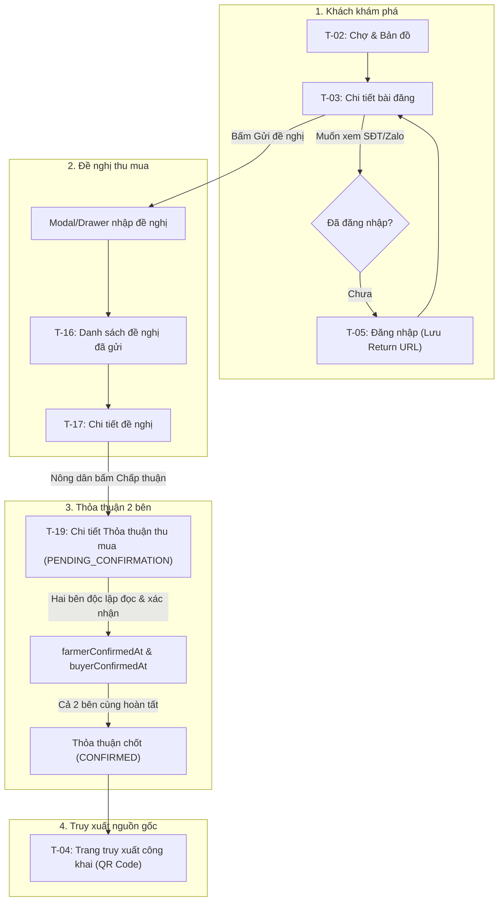

# 🏛️ Kiến trúc Thông tin (Information Architecture — IA) — MEKAGREEN

> **Vị trí quy trình:** Bước 4 trong Quy trình UI/UX (sau *Product Definition*, *UI/UX Direction*, và *References*) — tuân thủ chuẩn mực [UIUX_PLANNING_PROMPT.md](./UIUX_PLANNING_PROMPT.md).  
> **Mục tiêu:** Định hình cấu trúc điều hướng, phân quyền truy cập, danh mục chính xác 23 mẫu trang tái sử dụng (Page Templates), và luồng chuyển hướng ngữ cảnh cho đồ án chuyên ngành 2 tháng.  
> **Nguyên tắc cốt lõi:**  
> - Tối đa hóa khả năng tái sử dụng (State-aware & Role-aware templates), không sinh trang riêng cho từng trạng thái.  
> - Tuyệt đối không đưa vào các tính năng ngoài MVP (không thanh toán, không vận chuyển, không hóa đơn, không chữ ký số, không chat).  
> - Chưa viết code hoặc vẽ wireframe ở giai đoạn này.

---

## 1. Nguyên tắc Tổ chức Kiến trúc Thông tin

1. **Kiểm soát Phạm vi nghiêm ngặt (23 Page Templates Max):** Toàn bộ giao diện hệ thống được quy về đúng 23 mẫu trang/route có khả năng tái sử dụng cao. Mọi màn hình đều phục vụ trực tiếp cho chuỗi giá trị cốt lõi:
   $$\text{Vùng sản xuất} \rightarrow \text{Mùa vụ} \rightarrow \text{Nhật ký} \rightarrow \text{Nguồn cung} \rightarrow \text{Bản đồ/Chợ} \rightarrow \text{Đề nghị} \rightarrow \text{Thỏa thuận} \rightarrow \text{Truy xuất}$$
2. **Thiết kế Thích ứng Ngữ cảnh (State-Aware & Role-Aware):** 
   - Thay vì tạo 2 trang riêng cho người bán và người mua xem Đề nghị thu mua, chỉ tạo **1 template `T-17`**; các nút hành động tự động thay đổi dựa trên vai trò người xem và trạng thái của đề nghị.
   - Thỏa thuận thu mua dùng chung **1 template `T-19`** cho cả Nông dân, Thương lái và Quản trị viên.
3. **Phân cấp Truy cập Rõ ràng (Access Tiering):**
   - **Tầng Công khai (Public):** Dành cho mọi người dùng và khách vãng lai (Guest). Xem danh sách, bản đồ, thông tin mùa vụ, trang truy xuất QR.
   - **Tầng Bảo vệ Liên hệ (Gated Contacts):** Chỉ hiển thị số điện thoại, Zalo, Facebook cho người dùng đã đăng nhập (`BUYER` / `FARMER`).
   - **Tầng Tác vụ Nghiệp vụ (Protected Operations):** Phân quyền chặt chẽ theo vai trò xác thực (`FARMER`, `BUYER`, `ADMIN`).

---

## 2. Cấu trúc Điều hướng theo Vai trò (Navigation Structure)

### 2.1. Khách vãng lai (Guest / Public User)
- **Thanh điều hướng chính (Top Navbar):**
  - `[Logo MEKAGREEN]` $\rightarrow$ Về Trang chủ (`T-01`)
  - `[Chợ nguồn cung & Bản đồ]` $\rightarrow$ Khám phá nguồn cung (`T-02`)
  - `[Truy xuất nguồn gốc]` $\rightarrow$ Nhập mã tra cứu hoặc quét QR (`T-04`)
  - `[Đăng nhập]` (`T-05`) | `[Đăng ký]` (`T-06`)
- **Trải nghiệm trên trang chi tiết:** Xem đầy đủ thông tin nông sản, sản lượng, vùng trồng, nhưng khối liên hệ hiển thị nút `[🔒 Đăng nhập để xem liên hệ nhà vườn]`.

### 2.2. Nông dân / Hợp tác xã (Role: `FARMER`)
*Phân biệt loại tài khoản qua `accountType`: `INDIVIDUAL` (Nông hộ cá thể) hoặc `COOPERATIVE` (Hợp tác xã).*
- **Thanh điều hướng / Sidebar Quản trị:**
  - `[Tổng quan]` $\rightarrow$ Bảng điều khiển nông dân (`T-07`)
  - `[Vùng sản xuất]` $\rightarrow$ Danh sách vùng đất/vườn (`T-08`)
  - `[Mùa vụ & Nhật ký]` $\rightarrow$ Quản lý mùa vụ & ghi nhật ký (`T-11`)
  - `[Nguồn cung thu hoạch]` $\rightarrow$ Quản lý bài đăng bán trước thu hoạch (`T-14`)
  - `[Đề nghị thu mua]` $\rightarrow$ Danh sách đề nghị nhận được từ người mua (`T-16`)
  - `[Thỏa thuận thu mua]` $\rightarrow$ Danh sách thỏa thuận 2 bên đã xác nhận (`T-18`)
  - `[Chợ nguồn cung]` $\rightarrow$ Xem thị trường chung (`T-02`)
  - `[Tài khoản]` $\rightarrow$ Thông tin nhà vườn & kênh liên hệ SĐT/Zalo (`T-20`)

### 2.3. Bên mua / Thương lái / Doanh nghiệp thu mua (Role: `BUYER`)
*Hồ sơ kinh doanh: Thương lái, Doanh nghiệp thu mua, Nhà máy chế biến, Đơn vị xuất khẩu, v.v.*
- **Thanh điều hướng / Top Bar hoặc Sidebar:**
  - `[Chợ nguồn cung & Bản đồ]` $\rightarrow$ Tìm kiếm nông sản & vùng nguyên liệu (`T-02`)
  - `[Tổng quan]` $\rightarrow$ Bảng điều khiển người mua (`T-07`)
  - `[Đề nghị đã gửi]` $\rightarrow$ Theo dõi trạng thái các đề nghị thu mua (`T-16`)
  - `[Thỏa thuận của tôi]` $\rightarrow$ Quản lý các thỏa thuận thu mua đã xác nhận (`T-18`)
  - `[Tài khoản]` $\rightarrow$ Hồ sơ đơn vị thu mua & thông tin liên hệ (`T-20`)

### 2.4. Quản trị viên (Role: `ADMIN`)
*Quản trị nền tảng, kiểm duyệt nội dung — Không đóng vai trò cơ quan cấp chứng nhận pháp lý.*
- **Sidebar Quản trị viên:**
  - `[Tổng quan]` $\rightarrow$ Báo cáo tổng hợp số liệu vận hành (`T-07`)
  - `[Quản lý Người dùng]` $\rightarrow$ Danh sách nông dân, thương lái, kiểm tra tài khoản (`T-21`)
  - `[Kiểm duyệt Nguồn cung]` $\rightarrow$ Rà soát bài đăng, kiểm tra tọa độ, gỡ bài sai lệch (`T-21`)
  - `[Kiểm tra Hồ sơ / Chứng nhận]` $\rightarrow$ Rà soát giấy tờ đính kèm do nông dân tải lên (`T-21`)
  - `[Giám sát Thỏa thuận]` $\rightarrow$ Xem lịch sử xác nhận thỏa thuận thu mua (`T-21`)
  - `[Chi tiết Xử lý vi phạm]` $\rightarrow$ Màn hình khóa bài đăng/tài khoản (`T-22`)

---

## 3. Danh mục Chi tiết 23 Mẫu Trang Tái sử dụng (Page Template Inventory)

| Mã | Tên Mẫu Trang (Page Template) | Quyền Truy cập | Mục đích & Trách nhiệm UX |
|:---|:------------------------------|:---------------|:--------------------------|
| **NHÓM 1: CÔNG KHAI & KHÁM PHÁ (PUBLIC & DISCOVERY)** | | | |
| `T-01` | **Trang chủ (Landing Page)** | Public | **Hero Banner Full-Bleed Panoramic Immersive:**  • Hình ảnh nông nghiệp Nam Bộ góc rộng tràn 100% chiều ngang, phong cách Premium Agritech, tối ưu WebP.  • Lớp phủ gradient bảo đảm chuẩn tương phản WCAG 2.1 AA.  • Tiêu đề chính thức: *"Kết nối nguồn cung nông sản – Chủ động trước mùa thu hoạch"*.  • 2 nút CTA phân luồng nổi bật: `[Khám phá nguồn cung]` (chuyển sang `T-02`) và `[Đăng nguồn cung]` (chuyển sang `T-06` hoặc `T-15`).  • Thanh tìm kiếm nông sản nổi đè phía dưới banner (Sourcing Search Dock) kết nối trực tiếp với Chợ nguồn cung.  • Tuyệt đối không dùng thông tin thống kê giả mạo, tuyên bố chứng nhận hay xác thực chưa có cơ sở. |
| `T-02` | **Chợ Nguồn cung & Bản đồ (Marketplace & Agricultural Map)** | Public | Màn hình khám phá trọng tâm: Tìm kiếm từ khóa, bộ lọc đa cấp (Tỉnh/Thành phố → Xã/Phường theo cơ cấu 2026, Nông sản, Sản lượng, Ngày thu hoạch). Kết hợp danh sách thẻ và bản đồ tương tác (tỷ lệ bố cục tinh chỉnh ở bước Wireframe). |
| `T-03` | **Chi tiết Nguồn cung thu hoạch (Harvest Listing Detail)** | Public *(Liên hệ: Login)* | Trình bày toàn diện: Tên nông sản, giống, ảnh thực tế, thanh tiến độ cam kết sản lượng (`expected`, `committed`, `available`), bối cảnh mùa vụ và vùng trồng, khối SĐT/Zalo (mở khóa khi đăng nhập), nút mở Drawer gửi đề nghị thu mua. |
| `T-04` | **Trang Truy xuất Nguồn gốc Công khai (Public Traceability Page)** | Public | Giao diện tối ưu cực nhanh cho thiết bị di động khi quét mã QR hoặc nhập mã tra cứu: Xem nguồn gốc vùng trồng, mùa vụ, các mốc nhật ký canh tác cốt lõi, xem ảnh chứng nhận đính kèm, hiển thị tuyên bố miễn trừ trách nhiệm của hệ thống. |
| **NHÓM 2: XÁC THỰC & HỒ SƠ TÀI KHOẢN (AUTH & PROFILE)** | | | |
| `T-05` | **Đăng nhập (Login)** | Public | Đăng nhập tài khoản bằng Email/Số điện thoại + Mật khẩu. Hỗ trợ cơ chế ghi nhớ URL chuyển hướng (Redirect Back) để người dùng quay lại đúng bài đăng vừa xem. |
| `T-06` | **Đăng ký (Register & Onboarding)** | Public | Luồng đăng ký 2 bước tinh gọn: Chọn vai trò (`FARMER` / `BUYER`) $\rightarrow$ Chọn loại tài khoản (`INDIVIDUAL` / `COOPERATIVE` cho Farmer) hoặc chọn hồ sơ kinh doanh (cho Buyer) $\rightarrow$ Điền thông tin cơ bản. |
| `T-20` | **Hồ sơ Cá nhân & Cài đặt (Profile & Settings)** | Authenticated (All) | Quản lý thông tin liên hệ công khai (Số điện thoại, link Zalo, Facebook), cập nhật thông tin giới thiệu, hiển thị huy hiệu loại tài khoản/hồ sơ kinh doanh, đổi mật khẩu. |
| **NHÓM 3: TỔNG QUAN & TÁC VỤ NÔNG DÂN/HTX (FARMER OPERATIONS)** | | | |
| `T-07` | **Bảng điều khiển Tổng quan (Dashboard)** | Authenticated (Role-aware) | Template dùng chung tự điều chỉnh widget theo vai trò:  • Farmer: Thống kê nhanh bài đăng, đề nghị thu mua mới đến.  • Buyer: Đề nghị đang chờ phản hồi, thỏa thuận đã chốt.  • Admin: Số bài đăng mới, chứng nhận chờ kiểm tra. |
| `T-08` | **Danh sách Vùng sản xuất (Production Area List)** | Farmer | Bảng/danh sách các mảnh vườn, vùng trồng của nông hộ hoặc các điểm vùng của HTX. Thể hiện diện tích, vị trí và trạng thái canh tác. |
| `T-09` | **Chi tiết Vùng sản xuất (Production Area Detail)** | Farmer, Admin, Public view | Xem chi tiết một vùng sản xuất: Tọa độ điểm trên bản đồ, giấy tờ chứng nhận đính kèm, danh sách các mùa vụ đã và đang diễn ra tại vùng này. |
| `T-10` | **Form Vùng sản xuất (Production Area Form)** | Farmer | Màn hình tạo mới / chỉnh sửa vùng sản xuất: Nhập tên vùng, nhập diện tích thủ công, chọn vị trí điểm (Latitude/Longitude) trên bản đồ, tải lên ảnh chụp giấy chứng nhận (nếu có). |
| `T-11` | **Chi tiết Mùa vụ & Dòng thời gian Nhật ký (Crop Season & Log Timeline)** | Farmer, Admin | Xem chi tiết mùa vụ: Giống cây, ngày bắt đầu, khoảng thời gian dự kiến thu hoạch; dòng thời gian (Vertical Timeline) nhật ký canh tác; liên kết tới bài đăng nguồn cung. |
| `T-12` | **Form Mùa vụ (Crop Season Form)** | Farmer | Màn hình tạo mới / chỉnh sửa mùa vụ: Chọn vùng sản xuất trực thuộc, chọn loại cây và giống, ngày xuống giống, khoảng thời gian dự kiến thu hoạch. |
| `T-13` | **Form Ghi Nhật ký Canh tác (Farming Log Entry Form)** | Farmer | Form nhập liệu nhanh (dạng Modal/Drawer ưu tiên di động): Chọn ngày, chọn thẻ hoạt động canh tác định sẵn (Làm đất, Bón phân, Tưới nước, Phun thuốc vi sinh, Thu hoạch), nhập vật tư/ghi chú, chụp ảnh đính kèm. |
| `T-14` | **Quản lý Nguồn cung của tôi (My Harvest Listings)** | Farmer | Danh sách các đợt thu hoạch dự kiến do nông dân đăng bán: Thể hiện sản lượng dự kiến, sản lượng đã cam kết, sản lượng còn lại, trạng thái bài đăng (`AVAILABLE`, `PARTIALLY_COMMITTED`, `FULLY_COMMITTED`, `CLOSED`). |
| `T-15` | **Form Đăng Nguồn cung thu hoạch (Harvest Listing Form)** | Farmer | Màn hình đăng tin thu hoạch: Chọn mùa vụ, nhập sản lượng dự kiến, ngày bắt đầu thu hoạch, mức giá tham khảo (VNĐ/kg), ghi chú đóng gói. Có dòng hướng dẫn gợi ý đăng trước 15–30 ngày (không chặn đăng). |
| **NHÓM 4: ĐỀ NGHỊ THU MUA & THỎA THUẬN (PROPOSALS & AGREEMENTS)** | | | |
| `T-16` | **Danh sách Đề nghị thu mua (Purchase Proposal List)** | Role-aware (Farmer & Buyer) | Template danh sách dùng chung:  • Farmer: "Đề nghị thu mua nhận được" (từ các thương lái).  • Buyer: "Đề nghị thu mua đã gửi" (đến các nhà vườn).  Bộ lọc trạng thái: `PENDING`, `ACCEPTED`, `REJECTED`, `WITHDRAWN`, `EXPIRED`. |
| `T-17` | **Chi tiết Đề nghị thu mua (Purchase Proposal Detail)** | Role-aware (Farmer & Buyer) | Xem chi tiết nội dung đề nghị (sản lượng, giá đề xuất, thời gian giao nhận, ghi chú). Nút hành động tự thích ứng:  • Farmer: `[Đồng ý]` $\rightarrow$ Tạo Thỏa thuận thu mua, hoặc `[Từ chối]`.  • Buyer: `[Rút đề nghị]` (khi đang ở trạng thái `PENDING`). |
| `T-18` | **Danh sách Thỏa thuận thu mua (Procurement Agreement List)** | Role-aware (Farmer & Buyer) | Danh sách quản lý các thỏa thuận đã được tạo ra trên hệ thống giữa 2 bên. Lọc theo trạng thái (`CONFIRMED`, `CANCELLED`). |
| `T-19` | **Chi tiết Thỏa thuận thu mua (Procurement Agreement Detail)** | Shared (Farmer, Buyer, Admin) | Bản ghi thỏa thuận thu mua chính thức: Mã thỏa thuận, thông tin 2 bên, điều khoản sản lượng, đơn giá, thời gian thu hoạch, phương thức giao nhận ghi chú, dấu thời gian xác nhận của 2 bên. Hộp cảnh báo pháp lý bắt buộc (không phải chữ ký số). Tùy chọn xuất file PDF. |
| **NHÓM 5: QUẢN TRỊ HỆ THỐNG (ADMIN MODULE)** | | | |
| `T-21` | **Trung tâm Quản trị Dữ liệu (Admin Records Management)** | Admin | Template bảng dữ liệu linh hoạt (Data Table với tab lọc):  • Tab 1: Danh sách tài khoản người dùng (`FARMER`, `BUYER`).  • Tab 2: Danh sách bài đăng nguồn cung trên toàn sàn.  • Tab 3: Danh sách giấy tờ/chứng nhận cần rà soát.  • Tab 4: Danh sách thỏa thuận thu mua trên nền tảng. |
| `T-22` | **Chi tiết Rà soát & Xử lý Vi phạm (Admin Review & Moderation Detail)** | Admin | Xem chi tiết nội dung bị khiếu nại hoặc bài đăng có thông tin sai lệch: Thực hiện thao tác gắn cờ cảnh báo, ẩn bài đăng khỏi Chợ/Bản đồ, hoặc tạm khóa tài khoản vi phạm. |
| **NHÓM 6: TIỆN ÍCH HỆ THỐNG & TRANG THÔNG BÁO (SYSTEM & UTILITY)** | | | |
| `T-23` | **Trang Tiện ích & Trạng thái Hệ thống (System Status & Error Pages)** | Public & Authenticated | Template dùng chung hiển thị các trạng thái hệ thống: Lỗi `404 Không tìm thấy trang`, Lỗi `403 Không có quyền truy cập`, Thông báo xác nhận tài khoản, Thông báo hệ thống bảo trì. |

---

## 4. Cơ chế Điều hướng Ngữ cảnh & Xử lý Luồng Người dùng (Contextual Flows)

### 4.1. Cơ chế Mở khóa Thông tin Liên hệ (Contact Gating Flow)
1. Khách vãng lai xem bài đăng thu hoạch tại `T-03`.
2. Khối thông tin liên hệ bị ẩn: `[🔒 Đăng nhập để xem SĐT & Zalo nhà vườn]`.
3. Khách bấm nút $\rightarrow$ Chuyển hướng tới `T-05 (Đăng nhập)` kèm tham số `?returnUrl=/supply/123`.
4. Sau khi đăng nhập thành công $\rightarrow$ Hệ thống tự động chuyển lại `T-03`, khối liên hệ lập tức mở khóa đầy đủ nút gọi điện thoại và nhắn Zalo.

### 4.2. Cơ chế Chuyển đổi từ Đề nghị sang Thỏa thuận thu mua
1. Bên mua gửi đề nghị thu mua từ `T-03` $\rightarrow$ Hệ thống tạo bản ghi trạng thái `PENDING`.
2. Nông dân nhận thông báo, mở xem tại `T-17 (Chi tiết Đề nghị thu mua)`.
3. Nông dân chọn `[Đồng ý đề nghị]` $\rightarrow$ Hệ thống tự động tạo bản ghi **Thỏa thuận thu mua** tại `T-19` với đầy đủ các thông tin đã thống nhất.
4. Cả Nông dân và Bên mua lần lượt bấm nút `[Xác nhận thỏa thuận]` trên trang `T-19`.
5. Khi cả 2 bên cùng hoàn tất xác nhận $\rightarrow$ Thỏa thuận chính thức chuyển sang trạng thái `CONFIRMED`, hệ thống ghi nhận dấu thời gian bất biến và khóa chỉnh sửa.

---

## 5. Danh sách Các Tính năng Bị Loại bỏ dứt khoát khỏi Kiến trúc (Scope Safeguards)

Để bảo đảm thời gian hoàn thành đồ án trong 2 tháng, Kiến trúc Thông tin MEKAGREEN **tuyệt đối không thiết kế các màn hình/chức năng sau**:
- ❌ **Không có luồng thanh toán:** Không có trang giỏ hàng, thanh toán qua cổng ngân hàng/VNPay/Momo, ví tiền điện tử hay ký quỹ (escrow).
- ❌ **Không có luồng quản lý vận chuyển:** Không có màn hình đặt xe tải, tích hợp đơn vị vận chuyển (GHTK, Viettel Post), theo dõi định vị tài xế.
- ❌ **Không có luồng hóa đơn & thuế:** Không có màn hình xuất hóa đơn điện tử (VAT/hóa đơn đỏ).
- ❌ **Không có luồng chữ ký số pháp lý:** Không tích hợp chứng thư số USB Token/VNPT-CA/Viettel-CA.
- ❌ **Không có luồng Chat trực tuyến thời gian thực:** Tránh phức tạp hóa hạ tầng WebSocket; việc liên hệ trực tiếp được điều hướng qua điện thoại/Zalo cá nhân của hai bên.
- ❌ **Không có vẽ bản đồ Polygon phức tạp:** Nông dân chỉ chấm điểm tọa độ (Point) trên bản đồ.

---

## 6. Kết luận & Điểm dừng Phê duyệt

Kiến trúc Thông tin trên đã:
1. Quy chuẩn hóa chính xác **23 mẫu trang** tái sử dụng tối đa, không dư thừa.
2. Xác định rõ ràng cây điều hướng cho cả 4 nhóm đối tượng: Guest, Farmer, Buyer và Admin.
3. Bảo vệ trọn vẹn các quy tắc nghiệp vụ đã thống nhất (bảo vệ thông tin liên hệ, cam kết sản lượng linh hoạt, thỏa thuận 2 bên minh bạch).
4. Khóa chặt phạm vi thực tế cho dự án 2 tháng.

> 🛑 **Điểm dừng phê duyệt:**  
> Kính mời bạn xem xét và duyệt tài liệu **Kiến trúc Thông tin (Information Architecture)** này.  
> Sau khi bạn đồng ý, chúng ta sẽ tiếp tục bước kế tiếp trong quy trình: **User Flows (Sơ đồ Luồng Người dùng Chi tiết từng Vai trò & Trạng thái)**.
