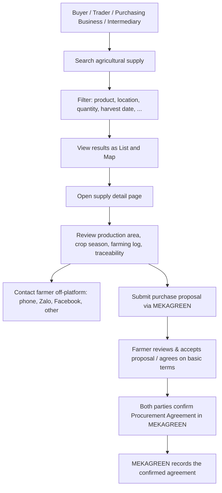

# 🗺️ Product Plan — MEKAGREEN

## Vision
<!-- Describe the long-term vision of the product -->
Connect buyers of agricultural produce with farmers' available supply, and make the production context
(production area, crop season, farming log, traceability) transparent enough that buyers can trust what they source.

## Target Users
<!-- Who are the primary users of this platform? -->
| User Group | Examples | Role on Platform |
|------------|----------|------------------|
| User Group | Examples | Role on Platform |
|------------|----------|------------------|
| **Buyer side** | Individual trader (thương lái), agricultural intermediary, purchasing company (doanh nghiệp thu mua), wholesaler, processor, exporter, cooperative buyer, agricultural purchasing unit | Searches supply, reviews production context, contacts farmers, submits purchase proposals. Auth role `BUYER` (business types are profiles, NOT separate auth roles). |
| **Supply side** | Individual Farmer / Household (nông hộ), Cooperative (HTX) | Publishes supply, maintains production-area / crop-season / farming-log data, responds to proposals. Auth role `FARMER` with `accountType` = `INDIVIDUAL` \| `COOPERATIVE` (see D4). |
| **Admin** | Platform operator | Moderation, master data, user & document review. Not a legal certification authority. |

---

## Core Buyer Journey (MVP) — Confirmed 2026-10-08

**Steps**
1. **Search** agricultural supply.
2. **Filter** by product, location (Tỉnh/TP → Đơn vị cơ sở theo danh mục chính thức hiện hành năm 2026, không bắt buộc cấp huyện; phân biệt tên hành chính chính thức và địa danh lịch sử / vùng canh tác quen thuộc, vd: Tiền Giang thuộc Đồng Tháp, Mỹ Đức Đông thuộc Mỹ Đức Tây), quantity, expected harvest date range (linh hoạt).
3. **View results** as a **list** and on a **map**.
4. **Open a supply detail page**.
5. **Review context**: production area, crop season, farming log, traceability information.
6. **Contact the farmer (optional)** using the contact methods the farmer provided: phone, Zalo, Facebook, other links. **Requires login** (see D1).
7. **Submit a purchase proposal (optional)** through MEKAGREEN. Statuses: `PENDING`, `ACCEPTED`, `REJECTED`, `WITHDRAWN`, `EXPIRED`.
8. **Agree on basic procurement terms**: farmer accepts proposal and both parties confirm basic procurement terms.
9. **Record the agreement**: MEKAGREEN stores the confirmed **Thỏa thuận thu mua** (Procurement Agreement) as a record of mutual confirmation.

> ⚠️ A confirmed agreement is a **record of mutual confirmation on the platform**.
> It is **NOT** a legally qualified electronic signature (chữ ký số / chữ ký điện tử có giá trị pháp lý)
> and must not be presented or marketed as "Hợp đồng điện tử có giá trị pháp lý". See [BUSINESS_RULES.md](./BUSINESS_RULES.md) (BR-040 – BR-049) and ADR-005 in [DECISIONS.md](./DECISIONS.md).

---

## Confirmed Product Decisions — 2026-10-08

> These are confirmed **business requirements**. Data model, database and concurrency design are deferred to the ERD/backend phase.

### D1. Contact information requires login
- A **logged-in BUYER** can view direct contact information (phone, Zalo, Facebook, other direct links).
- **Guests** can still view Supply Listings and general production information. Direct contact information is hidden.
- A Purchase Proposal is **not** required before viewing contact information. **Login is enough** for the MVP.
- Reasons: reduce scraping/spam, protect Farmer privacy, encourage account creation, let the platform know which authenticated users access seller contact information.

### D2. Multiple Buyers per Harvest Listing & Soft Reserve (Phương án 1A)
- One Harvest Listing may be committed to **several Buyers**, each for part of the expected quantity.
- Conceptual quantities:
  - `expectedQuantity`: Tổng sản lượng dự kiến ban đầu.
  - `committedQuantity`: Tổng sản lượng của các thỏa thuận đã hoàn tất xác nhận (`CONFIRMED`).
  - `reservedQuantity`: Tổng sản lượng đang giữ chỗ tạm thời cho các thỏa thuận đã chấp nhận nhưng đang chờ 2 bên xác nhận.
  - `availableQuantity = expectedQuantity − committedQuantity − reservedQuantity`.
- Confirmed commitments + active reserves must **never exceed** the expected quantity. Concurrency safety strictly enforced.
- Cancellation of an unconfirmed agreement (`PENDING_CONFIRMATION`) releases `reservedQuantity` back to `availableQuantity` exactly once; it never automatically re-opens `CLOSED` or `CANCELLED` listings.
- Conceptual listing states: `AVAILABLE`, `PARTIALLY_COMMITTED`, `FULLY_COMMITTED`, `CLOSED`, `CANCELLED`.

### D3. Production Area map = point location only (MVP) & GPS Privacy Default
- A ProductionArea has a **point** location (`latitude`, `longitude`), which the Farmer selects on the map.
- The Farmer enters the area size manually.
- **Not required in MVP** (future / nice-to-have): polygon, GeoJSON, MySQL Spatial, land-boundary drawing, automatic area calculation.
- **Bảo vệ tọa độ GPS chính xác của nhà vườn (Quy tắc chính thức đã phê duyệt - BR-033b):**
  - Mặc định khi tạo vùng trồng, hệ thống **không công khai tọa độ chính xác** cho cộng đồng (`isGpsPublic = false`).
  - Trên Chợ và Bản đồ công khai, chỉ hiển thị vị trí gần đúng có nhãn **"Vị trí gần đúng"**.
  - Tọa độ chính xác chỉ được công khai nếu Nông dân chủ động chọn công khai.
  - Tuyệt đối **không tự động tiết lộ** tọa độ GPS chính xác sau khi Thỏa thuận thu mua đạt `CONFIRMED`. Nếu tọa độ được bảo mật, Bên mua và Nông dân tự trao đổi địa điểm giao nhận hàng cụ thể ngoài hệ thống MEKAGREEN (qua SĐT / Zalo / Facebook).
  - Nếu không có tọa độ GPS chính xác, hiển thị vị trí hành chính dạng văn bản, tuyệt đối không tạo điểm ghim giả mạo.

### D4. Supply side = individual farmers and cooperatives
- Both individual farmers/households and cooperatives (HTX) can supply.
- **Cooperative is NOT a separate auth role.** Use `role = FARMER` with `accountType = INDIVIDUAL | COOPERATIVE`.
- A cooperative can publish Production Areas, Crop Seasons, Farming Logs and Harvest Listings just like an individual Farmer.
- Advanced cooperative member management is **not** in the MVP.

### D5. Expected Harvest Timing (15–30 Days Recommendation)
- Farmers are encouraged to publish expected harvest listings ~15–30 days before harvest where appropriate.
- This is a **recommended workflow / guidance**, NOT a hard blocking rule.
- The platform does not block publishing if harvest date is outside 15–30 days.

## MVP Scope

### ✅ In Scope (11 Core Modules)
1. **Production Area** (Vùng sản xuất): Point location on map, manual area size, documents.
2. **Crop Season** (Mùa vụ): Linked to Production Area, start date, expected harvest window.
3. **Farming Log** (Nhật ký canh tác): Dated cultivation activity logs under a Crop Season.
4. **Expected Harvest Listing** (Nguồn cung dự kiến): Product, variety, quantities, expected harvest date.
5. **Agricultural Supply Marketplace** (Chợ nguồn cung): Search and multi-criteria filtering.
6. **Agricultural Digital Map** (Bản đồ nông nghiệp): Interactive map view of supply, point markers.
7. **External Contact** (Liên hệ nhà cung cấp): Phone, Zalo, Facebook, links (protected by login).
8. **Purchase Proposal** (Đề nghị thu mua): Direct in-platform procurement interest, simple statuses (`PENDING`, `ACCEPTED`, `REJECTED`, `WITHDRAWN`, `EXPIRED`).
9. **Procurement Agreement** (Thỏa thuận thu mua): Two-party platform confirmation record, immutable snapshot, disclaimer.
10. **Traceability** (Truy xuất thông tin sản xuất): Public traceability view, traceability code / QR resolving to URL.
11. **Admin Panel** (Quản trị): User management, content moderation, document review.

### ❌ Out of Scope (MVP)
- Payment processing / escrow
- Physical logistics, shipping, delivery tracking
- Invoicing (hóa đơn) / tax documents
- Legally qualified digital signatures or e-contracts
- Dispute resolution / legal enforcement of agreements
- Multi-round negotiation workflows / counter-offers
- Polygon / GeoJSON production-area boundaries, MySQL Spatial, automatic area calculation
- Advanced cooperative member management
- Realtime chat, IoT, blockchain, AI matching

---

## Core Features (MVP)
| #  | Feature / Module                               | Priority | Status         |
|----|------------------------------------------------|----------|----------------|
| 1  | User Authentication & Roles (`FARMER`, `BUYER`, `ADMIN`) | High | ⬜ Not Started |
| 2  | Production Area Management (Point location)    | High     | ⬜ Not Started |
| 3  | Crop Season & Farming Log Management           | High     | ⬜ Not Started |
| 4  | Expected Harvest Listing Management            | High     | ⬜ Not Started |
| 5  | Supply Search & Filtering (Marketplace)        | High     | ⬜ Not Started |
| 6  | Digital Agricultural Map (Point markers)       | High     | ⬜ Not Started |
| 7  | Farmer Contact Block (Login-protected)        | High     | ⬜ Not Started |
| 8  | Purchase Proposal Module (Simple statuses)     | High     | ⬜ Not Started |
| 9  | Procurement Agreement (Two-party confirmation) | High     | ⬜ Not Started |
| 10 | Traceability (Public page / QR resolving URL)  | Medium   | ⬜ Not Started |
| 11 | Admin Panel (Moderation & review)              | Medium   | ⬜ Not Started |

## Open Questions
- ~~Who is on the supply side?~~ → Resolved: D4 (Farmer / Cooperative via accountType)
- ~~Must a buyer log in to see farmer contact details?~~ → Resolved: D1 (Yes, login required)
- ~~Can several buyers hold confirmed agreements on the same listing?~~ → Resolved: D2 / ADR-008 (Yes, partial quantities with Soft Reserve)
- ~~Map: point or polygon?~~ → Resolved: D3 (Point only for MVP)
- ~~Should a proposal expire after a set number of days?~~ → Resolved: ADR-008 / Quy tắc 3A (Không tự động hết hạn theo số ngày cố định trong MVP; chỉ EXPIRED khi đóng/hủy bài đăng hoặc sản lượng thực tế còn lại không đủ; thiếu sản lượng tạm thời do giữ chỗ thì giữ PENDING)
- Map tile provider to use: Leaflet + OpenStreetMap vs Mapbox GL vs Google Maps? (Recommended: Leaflet + OSM for MVP)
- Can a buyer submit a Purchase Proposal immediately after registration without email/profile verification?

---

## Milestones
| Phase     | Description                     | Target Date |
|-----------|---------------------------------|-------------|
| Phase 1   | Project setup & documentation   | Oct 2026    |
| Phase 2   | Backend API scaffolding         | TBD         |
| Phase 3   | Frontend UI scaffolding         | TBD         |
| Phase 4   | Integration & testing           | TBD         |
| Phase 5   | Deployment                      | TBD         |

## Success Metrics
<!-- How will you measure if the product is successful? -->
TBD — candidates: number of active supply listings, buyer searches → detail views, contact clicks, proposals submitted, agreements confirmed.

---
> _Last updated: 2026-10-08_
