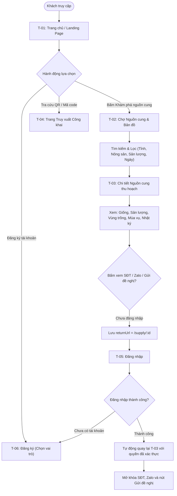
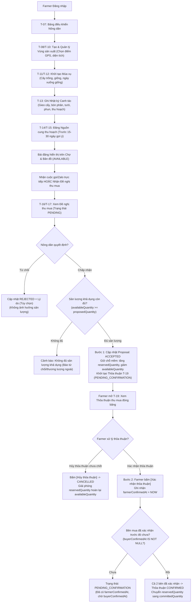
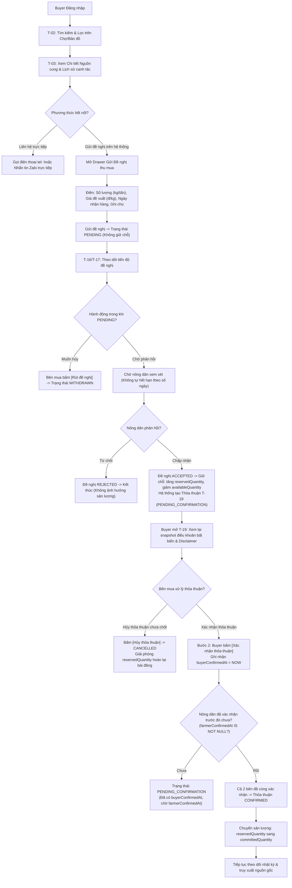
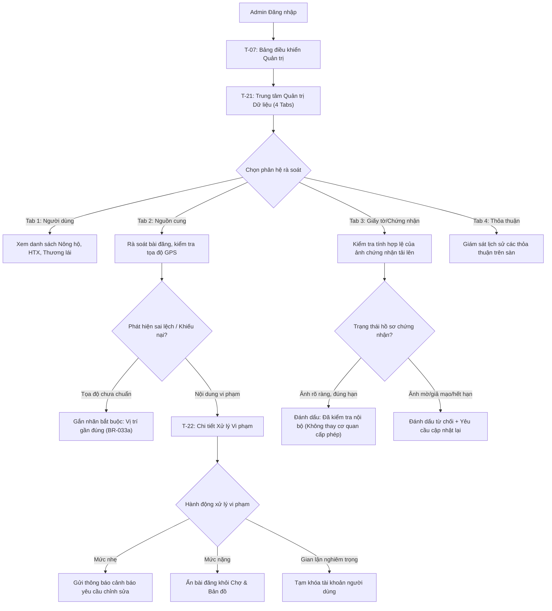
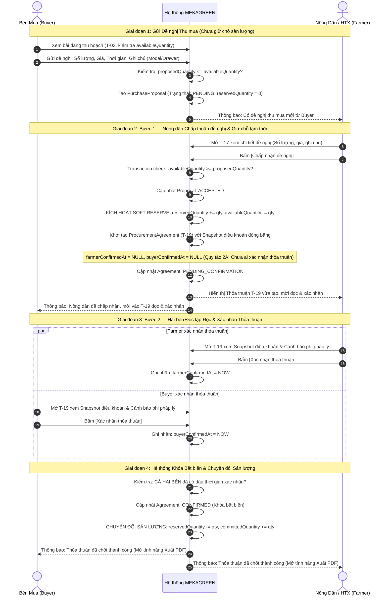

# 🔄 Sơ đồ Luồng Người dùng Chi tiết (User Flows & State Transitions) — MEKAGREEN

> **Vị trí quy trình:** Bước 5 trong Quy trình UI/UX (sau *Product Definition*, *UI/UX Direction*, *References*, và *Information Architecture*) — tuân thủ chuẩn mực [UIUX_PLANNING_PROMPT.md](./UIUX_PLANNING_PROMPT.md).  
> **Mục tiêu:** Mô tả chi tiết từng bước thao tác, điều kiện tiền đề, quyền hạn, chuyển đổi trạng thái và các điểm chờ xác nhận giữa hai bên cho 4 vai trò: Guest, Farmer, Buyer và Admin.  
> **Nguyên tắc cốt lõi:**  
> - Không tự ý bổ sung chức năng ngoài MVP (không thanh toán, không vận chuyển, không hóa đơn, không chữ ký số pháp lý, không chat WebSocket).  
> - Tuyệt đối không viết code Frontend, Backend, API hay Database ở giai đoạn này.

---

## 1. Nguyên tắc Thiết kế Luồng Người dùng

1. **Minh bạch Điểm chờ Hai bên (Explicit Waiting Handoffs):** Luồng tương tác giữa Người mua và Nông dân luôn thể hiện rõ ai đang nắm quyền hành động và ai đang ở trạng thái chờ (vd: *"Chờ nông dân phản hồi"* $\leftrightarrow$ *"Chờ người mua xác nhận thỏa thuận"*).
2. **Khóa Điều khoản Bất biến (Immutable Terms Payload):** Để tránh trường hợp hai bên hiểu lầm hoặc xác nhận hai nội dung khác nhau, thỏa thuận thu mua được tạo trực tiếp từ đề nghị được chấp thuận và giữ nguyên các trường dữ liệu cốt lõi (sản lượng, giá, thời gian, ghi chú). Cả hai bên cùng xác nhận trên đúng một bản ghi bất biến.
3. **Bảo toàn Sản lượng & Mô hình Giữ chỗ Tạm thời (Soft Reserve Guard — Quy tắc 1A):** Hệ thống phân biệt 3 đại lượng sản lượng và luôn duy trì công thức bảo toàn:
   $$\text{availableQuantity} = \text{expectedQuantity} - \text{committedQuantity} - \text{reservedQuantity}$$
   - Đề nghị ở trạng thái `PENDING`: Không giữ chỗ (`reservedQuantity = 0`).
   - Khi Nông dân chấp nhận đề nghị: Giữ chỗ tạm thời, chuyển sản lượng sang `reservedQuantity` và trừ ngay vào `availableQuantity`.
   - Khi cả hai bên cùng hoàn tất xác nhận: Chuyển sản lượng từ `reservedQuantity` sang `committedQuantity`.
   - Tuyệt đối không để $\text{committedQuantity} + \text{reservedQuantity} > \text{expectedQuantity}$.
4. **Cơ chế Khóa Thông tin Liên hệ có Ngữ cảnh (Seamless Contact Gating):** Khách chưa đăng nhập bấm xem liên hệ sẽ được lưu URL chuyển hướng (`returnUrl`), đăng nhập xong được đưa về đúng trang ban đầu và tự động mở khóa thông tin.
5. **Quy trình 2 Bước Độc lập (Two Distinct Steps — Quy tắc 2A):** Nông dân chấp nhận Purchase Proposal tại `T-17` chỉ chuyển trạng thái đề nghị thành `ACCEPTED` và khởi tạo Thỏa thuận tại `T-19`. Hệ thống **tuyệt đối KHÔNG tự động ghi nhận** `farmerConfirmedAt`. Nông dân và Bên mua mỗi bên phải thực hiện thao tác riêng biệt bấm `[Xác nhận thỏa thuận]` trên trang `T-19`. Thỏa thuận chỉ chuyển thành `CONFIRMED` khi cả hai bên đã cùng xác nhận trên cùng snapshot bất biến.
6. **Không Tự động Hết hạn Đề nghị theo Số ngày & Xử lý Thiếu sản lượng Tạm thời (Quy tắc 3A tinh chỉnh):** 
   - Đề nghị `PENDING` không tự động hết hạn theo số ngày cố định. Bên mua có quyền rút (`WITHDRAWN`), Nông dân có quyền từ chối (`REJECTED`).
   - Đề nghị chỉ chuyển sang `EXPIRED` vĩnh viễn khi bài đăng bị đóng (`CLOSED`), hủy (`CANCELLED`), hoặc sản lượng thực tế còn lại không thể đáp ứng ngay cả khi giải phóng hết giữ chỗ: $\text{expectedQuantity} - \text{committedQuantity} < \text{proposedQuantity}$. Đề nghị đã `EXPIRED` **không tự động khôi phục**.
   - Trường hợp thiếu sản lượng tạm thời do giữ chỗ ($\text{availableQuantity} < \text{proposedQuantity} \le \text{expectedQuantity} - \text{committedQuantity}$), đề nghị **vẫn giữ `PENDING`**, nút chấp nhận bị tạm khóa để chờ thỏa thuận giữ chỗ hoàn tất hoặc bị hủy, tránh làm hết hạn oan.
7. **Cơ chế Hủy Thỏa thuận Chưa hoàn tất (Approved Unconfirmed Cancellation):** Cả Farmer và Buyer đều có quyền hủy thỏa thuận `PENDING_CONFIRMATION` ngay cả khi một bên đã xác nhận, giải phóng `reservedQuantity` đúng một lần qua Database Transaction an toàn, bảo toàn dấu thời gian xác nhận trước đó để truy vết, và tuyệt đối không tự động mở lại bài đăng đã `CLOSED` hoặc `CANCELLED`.

---

## 2. Luồng Khách Vãng Lai (Guest User Flow)

Khách vãng lai có thể tự do khám phá thị trường và tra cứu nguồn gốc, nhưng thông tin liên hệ trực tiếp được bảo vệ để hạn chế thu thập rác và khuyến khích đăng ký.

### Các bước & Điều kiện thực thi:
- **Bước G-01:** Khách truy cập vào `T-01` hoặc `T-02`, thực hiện tìm kiếm từ khóa hoặc lọc theo địa giới hành chính Nam Bộ (Tỉnh/Thành phố → Xã/Phường theo cơ cấu 2026) và thời gian thu hoạch.
- **Bước G-02:** Xem danh sách bài đăng hoặc ghim trên bản đồ. Ghim không có tọa độ GPS chính xác sẽ hiển thị ghim hành chính kèm nhãn rõ ràng **"Vị trí gần đúng"** (BR-033a).
- **Bước G-03:** Mở `T-03` xem đầy đủ bối cảnh sản xuất. Khối liên hệ bị làm mờ nhẹ kèm nút: `[🔒 Đăng nhập để xem liên hệ nhà vườn]`. Nút `[Gửi đề nghị thu mua]` yêu cầu đăng nhập tài khoản Buyer.
- **Bước G-04 (Gating):** Khách bấm nút liên hệ $\rightarrow$ Hệ thống đính kèm tham số `?returnUrl=/supply/:id` chuyển sang `T-05`. Sau khi đăng nhập thành công, trình duyệt lập tức trở về đúng bài đăng đó và hiển thị đầy đủ SĐT, nút gọi `tel:` và link Zalo chat.

---

## 3. Luồng Nông Dân / Hợp Tác Xã (Farmer Flow)

*Áp dụng cho tài khoản `FARMER` với cả hai loại tài khoản: `INDIVIDUAL` (Nông hộ cá thể) và `COOPERATIVE` (Hợp tác xã).*

### Các bước & Điều kiện thực thi:
- **Bước F-01 (Vùng sản xuất):** Nông dân tạo Vùng sản xuất (`T-10`). Nhập tên vườn, diện tích (nhập tay), chấm điểm vị trí trên bản đồ (`latitude`, `longitude`). Tải lên ảnh giấy chứng nhận VietGAP/vùng trồng (nếu có).
- **Bước F-02 (Mùa vụ):** Tạo mùa vụ mới (`T-12`) gắn với vùng sản xuất đã tạo. Chọn giống cây, ngày bắt đầu và dự kiến thu hoạch.
- **Bước F-03 (Nhật ký canh tác):** Định kỳ ghi chép nhật ký (`T-13`) qua điện thoại di động: Chọn ngày, chọn thẻ hoạt động canh tác định sẵn, ghi chú vật tư, đính kèm ảnh thực tế.
- **Bước F-04 (Đăng tin nguồn cung):** Khi mùa vụ chuẩn bị đến ngày thu hoạch (hệ thống hiển thị lời nhắc gợi ý đăng trước 15–30 ngày, không chặn), nông dân điền sản lượng dự kiến (`expectedQuantity`), giá tham khảo và ngày bắt đầu thu hoạch.
- **Bước F-05 (Tiếp nhận & Chấp nhận đề nghị — Bước 1):** Khi có đề nghị gửi đến, đề nghị ở trạng thái `PENDING` (chưa giữ chỗ sản lượng). Nông dân vào `T-17` xem xét số lượng, giá và thời gian giao nhận:
  - **Nếu từ chối:** Chuyển sang `REJECTED`, gửi thông báo cho Bên mua (sản lượng không thay đổi).
  - **Nếu chấp nhận:** Hệ thống thực hiện kiểm tra transaction & concurrency (`availableQuantity >= proposedQuantity`). Nếu hợp lệ, hệ thống chuyển đề nghị thành `ACCEPTED`, **kích hoạt giữ chỗ mềm** (`reservedQuantity += proposedQuantity`, `availableQuantity -= proposedQuantity`), và tự động khởi tạo bản ghi **Thỏa thuận thu mua** tại `T-19` ở trạng thái `PENDING_CONFIRMATION` với snapshot điều khoản bất biến.  
    > ⚠️ **Quy tắc 2A:** Thao tác chấp nhận đề nghị này **TUYỆT ĐỐI KHÔNG tự động ghi nhận** `farmerConfirmedAt`. Nông dân mới chỉ đồng ý nguyên tắc bước đầu để tạo thỏa thuận.
  - **Nếu sản lượng khả dụng tạm thời không đủ do giữ chỗ ($\text{availableQuantity} < \text{proposedQuantity} \le \text{expectedQuantity} - \text{committedQuantity}$):** Đề nghị **vẫn giữ nguyên trạng thái `PENDING`** (không tự động hết hạn oan). Nút `[Chấp nhận]` trên `T-17` tạm thời bị khóa (disabled) kèm thông báo cảnh báo: *"Tạm thời chưa đủ sản lượng khả dụng do đang giữ chỗ cho thỏa thuận khác"*. Nông dân có thể đợi thỏa thuận kia kết thúc hoặc chủ động bấm từ chối.
- **Bước F-06 (Xác nhận thỏa thuận thu mua — Bước 2 riêng biệt):** Nông dân mở `T-19`, đọc kỹ lại snapshot điều khoản bất biến và cảnh báo miễn trừ trách nhiệm pháp lý (BR-047, BR-048):
  - **Nếu xác nhận:** Nông dân bấm nút `[Xác nhận thỏa thuận]`, hệ thống ghi nhận dấu thời gian `farmerConfirmedAt = NOW`. Nếu Bên mua cũng đã xác nhận trước đó, thỏa thuận chính thức chuyển sang `CONFIRMED` và chuyển toàn bộ sản lượng từ `reservedQuantity` sang `committedQuantity`. Nếu Bên mua chưa xác nhận, thỏa thuận tiếp tục giữ chỗ tạm thời và chờ Bên mua.
  - **Nếu hủy thỏa thuận chưa chốt (Đã phê duyệt):** Nông dân có quyền bấm `[Hủy thỏa thuận chưa chốt]` kèm lý do khi thỏa thuận đang ở `PENDING_CONFIRMATION` (kể cả khi Nông dân đã bấm xác nhận trước đó hoặc Bên mua đã bấm xác nhận trước đó, miễn là thỏa thuận chưa `CONFIRMED`). Thỏa thuận chuyển sang `CANCELLED`, hệ thống lưu `cancelledBy = FARMER`, `cancellationReason`, `cancelledAt` và **giữ nguyên toàn bộ lịch sử xác nhận trước đó** (`farmerConfirmedAt`, `buyerConfirmedAt`). Hệ thống giải phóng `reservedQuantity` đúng một lần bằng Database Transaction; nếu bài đăng đã `CLOSED` hoặc `CANCELLED`, hệ thống tuyệt đối không tự động mở lại bài đăng.

---

## 4. Luồng Bên Mua / Thương Lái / Doanh Nghiệp (Buyer Flow)

*Áp dụng cho tài khoản `BUYER` với các hồ sơ kinh doanh: Thương lái cá nhân, Doanh nghiệp thu mua, Nhà máy chế biến, Đơn vị xuất khẩu.*

### Các bước & Điều kiện thực thi:
- **Bước B-01 (Tìm nguồn hàng):** Bên mua sử dụng bộ lọc đa tiêu chí tại `T-02` để khoanh vùng các vườn sắp thu hoạch trong bán kính gom hàng phù hợp.
- **Bước B-02 (Thẩm định hồ sơ):** Mở `T-03` kiểm tra giống cây, xem ảnh thực tế vườn, rà soát nhật ký phân bón/thuốc, xem thanh tiến độ sản lượng (`expectedQuantity`, `committedQuantity`, `reservedQuantity`, `availableQuantity`).
- **Bước B-03 (Liên hệ & Chào mua — Giai đoạn Đề nghị):**
  - Có thể bấm gọi điện thoại hoặc Zalo để trao đổi sơ bộ ngoài nền tảng.
  - Hoặc bấm `[Gửi đề nghị thu mua]`, nhập số lượng muốn mua (không được vượt quá `availableQuantity`), mức giá đề xuất (VNĐ/kg), thời gian nhận hàng mong muốn và ghi chú đóng gói/vận chuyển.
  - Đề nghị được tạo ở trạng thái `PENDING`. **Quy tắc 1A:** Ở trạng thái này, hệ thống **chưa giữ chỗ** sản lượng (`reservedQuantity` chưa tăng).
  - Khi còn `PENDING`, Bên mua có quyền bấm `[Rút đề nghị]` (`WITHDRAWN`) bất kỳ lúc nào nếu thay đổi kế hoạch.
  - **Quy tắc 3A tinh chỉnh:** Đề nghị `PENDING` **không tự động hết hạn sau số ngày cố định**, và **không bị hết hạn oan** khi sản lượng khả dụng chỉ bị thiếu tạm thời do giữ chỗ cho thỏa thuận khác. Đề nghị chỉ chuyển sang `EXPIRED` vĩnh viễn khi bài đăng bị đóng/hủy, hoặc khi sản lượng thực tế còn lại không thể đáp ứng: $\text{expectedQuantity} - \text{committedQuantity} < \text{proposedQuantity}$. Đề nghị đã `EXPIRED` không tự động khôi phục.
- **Bước B-04 (Xem xét Thỏa thuận thu mua tại T-19 — Bước 2 riêng biệt):**
  - Khi Nông dân chấp nhận đề nghị, hệ thống giữ chỗ tạm thời (`reservedQuantity`), trừ vào `availableQuantity`, và khởi tạo Thỏa thuận tại `T-19` (`PENDING_CONFIRMATION`).
  - Bên mua nhận thông báo và truy cập `T-19`. Kiểm tra bảng snapshot điều khoản đã được cố định (không bị chỉnh sửa ngầm).
  - Đọc kỹ dòng cảnh báo miễn trừ trách nhiệm pháp lý (BR-047, BR-048).
  - **Nếu xác nhận:** Bấm `[Xác nhận thỏa thuận]`, ghi nhận dấu thời gian `buyerConfirmedAt = NOW`.
  - **Nếu hủy thỏa thuận chưa chốt (Đã phê duyệt):** Bên mua có quyền bấm `[Hủy thỏa thuận chưa chốt]` kèm lý do khi thỏa thuận đang ở `PENDING_CONFIRMATION` (kể cả khi Bên mua đã bấm xác nhận trước đó hoặc Nông dân đã bấm xác nhận trước đó, miễn là thỏa thuận chưa `CONFIRMED`). Thỏa thuận chuyển sang `CANCELLED`, hệ thống lưu vết `cancelledBy = BUYER`, `cancellationReason`, `cancelledAt` và **giữ nguyên toàn bộ lịch sử xác nhận trước đó** (`farmerConfirmedAt`, `buyerConfirmedAt`). Hệ thống giải phóng `reservedQuantity` đúng một lần bằng Database Transaction; nếu bài đăng đã `CLOSED` hoặc `CANCELLED`, hệ thống tuyệt đối không tự động mở lại bài đăng.
- **Bước B-05 (Hoàn tất cam kết khi CẢ HAI BÊN cùng xác nhận):**
  - Chỉ khi cả hai bên đều hoàn tất thao tác bấm xác nhận (`farmerConfirmedAt IS NOT NULL` và `buyerConfirmedAt IS NOT NULL`), thỏa thuận mới chính thức chuyển sang trạng thái `CONFIRMED`.
  - **Khóa bất biến:** Tuyệt đối không cho phép hủy thỏa thuận đã `CONFIRMED` thông qua chức năng hủy thỏa thuận chưa chốt.
  - Hệ thống chuyển đổi trạng thái sản lượng an toàn trong một database transaction:
    $$\text{reservedQuantity}_{\text{mới}} = \text{reservedQuantity}_{\text{cũ}} - \text{agreedQuantity}$$
    $$\text{committedQuantity}_{\text{mới}} = \text{committedQuantity}_{\text{cũ}} + \text{agreedQuantity}$$
    $$\text{availableQuantity} = \text{expectedQuantity} - \text{committedQuantity} - \text{reservedQuantity}$$
  - Nếu `availableQuantity == 0`, bài đăng tự động chuyển sang trạng thái hết sản lượng khả dụng (`FULLY_COMMITTED` / Không tiếp nhận đề nghị mới).

---

## 5. Luồng Quản Trị Viên (Admin Flow)

Quản trị viên chịu trách nhiệm giữ gìn môi trường kết nối trung thực, loại bỏ bài đăng sai sự thật và hỗ trợ người dùng; tuyệt đối không đóng vai trò cơ quan cấp chứng nhận pháp lý.

### Các bước & Quyền hạn thực thi:
- **Bước A-01 (Rà soát nguồn cung):** Quản trị viên duyệt danh sách bài đăng tại `T-21`. Kiểm tra thông tin cây trồng và tọa độ điểm. Nếu bài đăng chỉ có địa chỉ hành chính mà chưa có tọa độ GPS chính xác, hệ thống hiển thị nhãn **"Vị trí gần đúng"** (BR-033a).
- **Bước A-02 (Rà soát tài liệu):** Xem ảnh chụp chứng nhận VietGAP, GlobalGAP, mã số vùng trồng do nông dân tải lên. Quản trị viên chỉ đối chiếu thông tin cơ bản và gắn nhãn "Đã đối chiếu hồ sơ" (BR-060 quy định: MEKAGREEN không chứng nhận giá trị pháp lý hay bảo lãnh tiêu chuẩn).
- **Bước A-03 (Xử lý vi phạm):** Khi có bài đăng bị người dùng báo cáo (treo đầu dê bán thịt chó, sản lượng ảo, giá ảo), Admin truy cập `T-22` để ẩn bài đăng ngay lập tức hoặc khóa tài khoản vi phạm.

---

## 6. Luồng Trọng Tâm: Chuỗi Nghiệp vụ Đề nghị $\rightarrow$ Thỏa thuận $\rightarrow$ Xác nhận Hai bên

Đây là luồng nghiệp vụ quan trọng nhất của MEKAGREEN, kết nối Pillar 2 (Marketplace) sang Pillar 3 (Procurement Commitment) theo đúng các quy tắc 1A (Soft Reserve), 2A (Two Distinct Steps) và 3A (No Fixed Expiration).

---

## 7. Xử lý Các Trường hợp Ngoại lệ & Trạng thái Lỗi (Edge Cases & Failure States)

### 7.1. Đề nghị bị Nông dân Từ chối (`REJECTED`)
- **Tình huống:** Nông dân không đồng ý mức giá, số lượng hoặc thời gian giao hàng mà Bên mua đề xuất.
- **Xử lý UX:** 
  - Nông dân bấm `[Từ chối đề nghị]` trên trang `T-17`, có thể nhập lý do ngắn gọn (tùy chọn).
  - Trạng thái đề nghị lập tức chuyển thành `REJECTED`.
  - Bên mua nhận thông báo lý do từ chối. Sản lượng khả dụng của bài đăng hoàn toàn không bị ảnh hưởng.
  - Bên mua có thể liên hệ trực tiếp qua SĐT/Zalo để trao đổi thêm hoặc tìm bài đăng khác.

### 7.2. Đề nghị được Bên mua Rút lại (`WITHDRAWN`)
- **Tình huống:** Bên mua đã gửi đề nghị nhưng sau đó tìm được nguồn hàng khác hoặc thay đổi kế hoạch sản xuất kinh doanh.
- **Điều kiện:** Đề nghị phải đang ở trạng thái `PENDING` (Nông dân chưa bấm chấp nhận).
- **Xử lý UX:**
  - Bên mua vào `T-17` bấm nút `[Rút đề nghị]`.
  - Hệ thống hiển thị hộp thoại xác nhận: *"Bạn có chắc chắn muốn rút đề nghị này không?"*.
  - Sau khi xác nhận, trạng thái đề nghị chuyển thành `WITHDRAWN`. Nông dân không thể bấm chấp nhận đề nghị này nữa.

### 7.3. Đề nghị bị Hết hạn (`EXPIRED` — Quy tắc 3A tinh chỉnh)
- **Nguyên tắc cốt lõi (Quy tắc 3A):** Nền tảng **KHÔNG tự động hết hạn đề nghị theo số ngày cố định** (không áp dụng quy tắc 5 ngày). Khi đề nghị đang ở trạng thái `PENDING`:
  - Bên mua có toàn quyền bấm `[Rút đề nghị]` (`WITHDRAWN`).
  - Nông dân có toàn quyền bấm `[Từ chối đề nghị]` (`REJECTED`).
- **3 Điều kiện kích hoạt trạng thái `EXPIRED` vĩnh viễn:** Đề nghị ở trạng thái `PENDING` chỉ chuyển sang `EXPIRED` khi:
  1. **Bài đăng bị đóng (`CLOSED`):** Nông dân chủ động đóng bài đăng hoặc đã kết thúc mùa thu hoạch.
  2. **Bài đăng bị hủy (`CANCELLED`):** Do thiên tai, dịch bệnh hoặc mùa vụ thất thu.
  3. **Sản lượng thực tế còn lại vĩnh viễn không thể đáp ứng:** Ngay cả khi toàn bộ các thỏa thuận đang giữ chỗ (`reservedQuantity`) bị hủy đi chăng nữa, thì lượng sản lượng đã chính thức chốt (`committedQuantity`) cũng đã khiến phần còn lại không đủ để đáp ứng đề nghị:
     $$\text{expectedQuantity} - \text{committedQuantity} < \text{proposedQuantity}$$
- **Quy tắc quan trọng về Đề nghị đã Hết hạn:** Đề nghị đã chuyển sang `EXPIRED` **tuyệt đối không tự động khôi phục**. Nếu sau đó nông sản có thêm hoặc kế hoạch thay đổi, Bên mua có thể tạo một đề nghị thu mua mới.
- **Xử lý Thiếu sản lượng Tạm thời do Giữ chỗ (Tránh hết hạn oan):**
  - Khi $\text{availableQuantity} < \text{proposedQuantity} \le \text{expectedQuantity} - \text{committedQuantity}$: Thiếu hụt sản lượng lúc này chỉ là **tạm thời** do một thỏa thuận khác đang chờ 2 bên xác nhận (`reservedQuantity`).
  - **Xử lý hệ thống & UX:** Đề nghị **vẫn giữ nguyên trạng thái `PENDING`**, KHÔNG bị chuyển `EXPIRED`.
  - Trên màn hình Nông dân (`T-17`): Nút `[Chấp nhận]` tạm thời bị vô hiệu hóa (disabled), hiển thị nhãn cảnh báo:  
    > ⏳ *"Tạm thời chưa đủ sản lượng khả dụng do đang giữ chỗ cho thỏa thuận khác. Nút chấp nhận sẽ tự mở lại nếu thỏa thuận đang giữ chỗ bị hủy."*
  - Nếu thỏa thuận giữ chỗ kia bị hủy (`CANCELLED`) $\rightarrow$ sản lượng giải phóng $\rightarrow$ nút `[Chấp nhận]` của đề nghị này tự động khả dụng trở lại!
  - Nếu thỏa thuận giữ chỗ kia được cả 2 bên xác nhận (`CONFIRMED`) và khiến $\text{expectedQuantity} - \text{committedQuantity} < \text{proposedQuantity}$ $\rightarrow$ khi đó hệ thống mới chính thức chuyển đề nghị này sang `EXPIRED` vĩnh viễn.

### 7.4. Xử lý Tranh chấp Sản lượng Đồng thời & An toàn Giao dịch (Concurrency & Idempotency)
- **Tình huống:** Bài đăng chỉ còn 10 tấn khả dụng (`availableQuantity = 10`). Cả Bên mua A và Bên mua B cùng gửi đề nghị mua 10 tấn (cả hai đều đang ở trạng thái `PENDING`).
- **Cơ chế Soft Reserve & An toàn giao dịch (Transaction Safety):**
  - Khi gửi đề nghị: Cả A và B đều thành công gửi đề nghị `PENDING` vì hệ thống **chưa giữ chỗ** ở bước này (`reservedQuantity = 0`, `availableQuantity` vẫn là 10).
  - Khi Nông dân mở xem và bấm `[Chấp nhận]` đề nghị của Bên mua A:
    - Backend thực thi một Database Transaction với cơ chế khóa dòng (Pessimistic Row Lock: `SELECT ... FOR UPDATE` trên bản ghi HarvestListing).
    - Hệ thống kiểm tra: `availableQuantity >= 10` (hợp lệ).
    - Cập nhật ngay: `reservedQuantity += 10`, `availableQuantity = 10 - 0 - 10 = 0`.
    - Đổi đề nghị A thành `ACCEPTED`, khởi tạo Thỏa thuận A (`PENDING_CONFIRMATION`).
    - Transaction hoàn tất (Commit).
  - Sau đó, khi Nông dân mở xem đề nghị của Bên mua B:
    - Hệ thống kiểm tra: `availableQuantity = 0 < 10` nhưng $\text{expectedQuantity} - \text{committedQuantity} = 20 - 0 = 20 \ge 10$.
    - Đề nghị B **vẫn giữ trạng thái `PENDING`** (không bị hủy oan). Nút `[Chấp nhận]` bị disabled kèm cảnh báo: *"Tạm thời chưa đủ sản lượng khả dụng do đang giữ chỗ cho thỏa thuận khác"*.
  - **Nguyên tắc bảo toàn nguyên tử (Idempotency Guard):**
    - Kiểm tra trạng thái nghiêm ngặt trước khi cập nhật; tuyệt đối không cộng/trừ sản lượng hai lần trong mọi tình huống (kể cả khi hai bên cùng bấm nút đồng thời).
    - Không xác nhận thỏa thuận đã bị hủy (`CANCELLED`).
    - Không hủy thỏa thuận đã được hai bên xác nhận (`CONFIRMED`).
    - Tuyệt đối không bao giờ để xảy ra tình trạng:
      $$\text{committedQuantity} + \text{reservedQuantity} > \text{expectedQuantity}$$

### 7.4.1. Tranh chấp Thao tác Đồng thời giữa Xác nhận và Hủy Thỏa thuận (Confirm vs. Cancel Race Condition)
- **Tình huống biên nhạy cảm:** Tại màn hình `T-19`, Nông dân bấm `[Hủy thỏa thuận chưa chốt]` tại đúng mili-giây Bên mua bấm `[Xác nhận thỏa thuận]` (hoặc ngược lại).
- **Cơ chế bảo đảm chỉ đúng MỘT thao tác thành công (Database Serialization):**
  - Cả hai thao tác (Xác nhận và Hủy) đều bắt buộc thực thi trong Database Transaction và kích hoạt khóa dòng bi quan: `SELECT * FROM procurement_agreements WHERE id = ? FOR UPDATE`.
  - **Kịch bản A (Giao dịch Xác nhận giành khóa trước):**
    1. Transaction Xác nhận đọc bản ghi khi `status == PENDING_CONFIRMATION`, ghi nhận dấu thời gian xác nhận.
    2. Nếu đây là bước xác nhận thứ hai (cả hai bên đã đủ dấu xác nhận), hệ thống chuyển `status = CONFIRMED`, trừ `reservedQuantity`, tăng `committedQuantity` trên bài đăng, rồi Commit transaction và nhả khóa dòng.
    3. Transaction Hủy đến sau giành được khóa, kiểm tra điều kiện tiên quyết: `status == PENDING_CONFIRMATION` $\rightarrow$ **Thất bại** (vì trạng thái hiện tại đã là `CONFIRMED`).
    4. Transaction Hủy lập tức bị từ chối (Rollback, trả mã lỗi HTTP 409 Conflict: *"Thỏa thuận đã được hai bên hoàn tất xác nhận, không thể hủy"*). Không có sản lượng nào bị giải phóng sai lệch.
  - **Kịch bản B (Giao dịch Hủy giành khóa trước):**
    1. Transaction Hủy đọc bản ghi khi `status == PENDING_CONFIRMATION`, cập nhật `status = CANCELLED`, lưu vết hủy và giải phóng `reservedQuantity` đúng một lần trên bài đăng, rồi Commit transaction và nhả khóa dòng.
    2. Transaction Xác nhận đến sau giành được khóa, kiểm tra điều kiện tiên quyết: `status == PENDING_CONFIRMATION` $\rightarrow$ **Thất bại** (vì trạng thái hiện tại đã là `CANCELLED`).
    3. Transaction Xác nhận lập tức bị từ chối (Rollback, trả mã lỗi HTTP 409 Conflict: *"Thỏa thuận đã bị hủy bởi đối tác, không thể xác nhận"*).
  - **Kết luận:** Hệ thống bảo đảm 100% không bao giờ xảy ra tình trạng thỏa thuận vừa được xác nhận vừa bị hủy, và sản lượng không bao giờ bị tăng/giảm sai lệch.

### 7.5. Chống Lệch Điều khoản giữa Hai bên (Preventing Desynchronization — Quy tắc 2A)
- **Nguyên tắc:** MEKAGREEN MVP **không áp dụng đàm phán nhiều vòng (counter-offers)** để tránh tình trạng sửa điều khoản qua lại gây nhầm lẫn.
- **Cơ chế đảm bảo:**
  - Khi Nông dân bấm `[Chấp nhận]`, hệ thống "đóng băng" (freeze) toàn bộ thông số: `Mã bài đăng`, `Số lượng`, `Đơn giá`, `Thời gian nhận hàng`, `Ghi chú`.
  - Bản ghi Thỏa thuận thu mua (`T-19`) được render từ đúng một snapshot dữ liệu duy nhất trong cơ sở dữ liệu.
  - Cả hai bên chỉ có duy nhất 1 quyền lựa chọn: **Bấm Xác nhận** hoặc **Hủy thỏa thuận** trên cùng một nội dung đó. Không bên nào được quyền sửa đổi câu chữ hay con số trong thỏa thuận.
  - Hệ thống chỉ đánh dấu `CONFIRMED` khi cả hai bên độc lập xác nhận trên đúng snapshot đó (`farmerConfirmedAt IS NOT NULL` và `buyerConfirmedAt IS NOT NULL`).
  - Nếu muốn thay đổi thỏa thuận: Hai bên tự thương lượng ngoài qua SĐT/Zalo, hủy thỏa thuận cũ và gửi một Đề nghị thu mua mới.

### 7.6. Cơ chế Hủy Thỏa thuận Chưa hoàn tất & Giải phóng Giữ chỗ (Approved Unconfirmed Cancellation)
> 📌 **Quy tắc nghiệp vụ chính thức đã phê duyệt:** Áp dụng cho các Thỏa thuận thu mua đang ở trạng thái `PENDING_CONFIRMATION` (đã được tạo ra nhưng chưa đạt `CONFIRMED`).

1. **Quyền hủy thỏa thuận chưa hoàn tất:**
   - **Nông dân (Farmer) và Bên mua (Buyer) đều có quyền hủy** thỏa thuận khi trạng thái là `PENDING_CONFIRMATION`.
   - **Cho phép hủy ngay cả khi một bên đã xác nhận:** Nếu Nông dân đã bấm xác nhận nhưng Bên mua chưa xác nhận, Bên mua vẫn được quyền bấm `[Hủy thỏa thuận chưa chốt]`. Ngược lại, nếu Bên mua đã xác nhận nhưng Nông dân chưa xác nhận, Nông dân vẫn được quyền bấm `[Hủy thỏa thuận chưa chốt]`.
   - **Tuyệt đối không cho phép hủy thỏa thuận `CONFIRMED`:** Chức năng này bị khóa hoàn toàn khi thỏa thuận đã đạt trạng thái `CONFIRMED`. Việc hủy hoặc giải quyết tranh chấp đối với thỏa thuận đã xác nhận là nghiệp vụ riêng, không tự ý đưa vào MVP.
2. **Quy tắc thời gian (Timeout Rule):**
   - Tuân thủ **Quy tắc 3A**: MVP **KHÔNG tự động hủy thỏa thuận đang chờ theo bộ đếm thời gian cố định** (không chạy cron job hủy sau N ngày nếu chưa có quy tắc được phê duyệt).
   - Việc hủy chỉ diễn ra khi một trong hai bên chủ động bấm nút hủy hoặc bài đăng bị đóng/hủy.
3. **Lưu vết minh bạch & Bảo toàn lịch sử:**
   - Người bấm hủy phải chọn hoặc nhập lý do trong Modal xác nhận.
   - Thỏa thuận chuyển sang trạng thái: `CANCELLED`.
   - Hệ thống bắt buộc lưu: `cancelledBy` (`FARMER` \| `BUYER`), `cancellationReason`, và `cancelledAt`.
   - **Bảo toàn lịch sử xác nhận:** Dấu thời gian xác nhận trước đó (`farmerConfirmedAt` hoặc `buyerConfirmedAt`) **được giữ nguyên vẹn**, không bị xóa hoặc reset về `NULL`, nhằm phục vụ truy vết lịch sử minh bạch (ai đã từng đồng ý, ai là người quyết định hủy sau đó).
4. **Giải phóng sản lượng giữ chỗ đúng một lần (Atomic & Idempotent Reserve Release):**
   - Hệ thống sử dụng Database Transaction, kiểm tra trạng thái trước khi cập nhật (`status == PENDING_CONFIRMATION`), đảm bảo việc giải phóng sản lượng **chỉ diễn ra đúng một lần duy nhất**, tránh trường hợp cả hai bên cùng bấm hủy đồng thời gây cộng dồn sản lượng hai lần:
     $$\text{reservedQuantity} \leftarrow \text{reservedQuantity} - \text{agreedQuantity}$$
     $$\text{availableQuantity} \leftarrow \text{availableQuantity} + \text{agreedQuantity}$$
5. **Nguyên tắc không tự động mở lại bài đăng đã `CLOSED` hoặc `CANCELLED`:**
   - Khi giải phóng sản lượng từ việc hủy thỏa thuận, hệ thống **chỉ cập nhật trạng thái sản lượng đối với bài đăng vẫn đang hoạt động** (`AVAILABLE`, `PARTIALLY_COMMITTED`, `FULLY_COMMITTED`).
   - Nếu bài đăng thu hoạch đã bị Nông dân đóng (`CLOSED`) hoặc hủy do mất mùa (`CANCELLED`), việc hủy thỏa thuận chỉ trừ `reservedQuantity` đúng một lần trên sổ kế toán để cân đối số liệu, **tuyệt đối giữ nguyên trạng thái `CLOSED` hoặc `CANCELLED`**, không bao giờ tự động chuyển bài đăng trở lại trạng thái mở (`AVAILABLE`/`PARTIALLY_COMMITTED`).

---

## 8. Ma Trận Quyền Hạn & Chuyển Đổi Trạng Thái

### 8.1. Ma trận Trạng thái Đề nghị Thu mua (Purchase Proposal States)

| Trạng thái | Ý nghĩa | Quyền Farmer | Quyền Buyer | Trạng thái kế tiếp có thể có |
|:---|:---|:---|:---|:---|
| `PENDING` | Mới gửi, chờ phản hồi (Chưa giữ chỗ) | Xem, Chấp nhận (nếu đủ sản lượng khả dụng), Từ chối | Xem, Rút đề nghị (`WITHDRAWN`) | `ACCEPTED`, `REJECTED`, `WITHDRAWN`, `EXPIRED` |
| `ACCEPTED` | Nông dân đã đồng ý, đã giữ chỗ mềm | Xem, Đọc snapshot & Xác nhận thỏa thuận tại `T-19` | Xem, Đọc snapshot & Xác nhận thỏa thuận tại `T-19` | *(Đóng vòng đời đề nghị, chuyển sang Thỏa thuận)* |
| `REJECTED` | Nông dân từ chối đề nghị | Xem lịch sử | Xem lý do từ chối | Trạng thái kết thúc |
| `WITHDRAWN` | Bên mua tự chủ động rút lại | Xem lịch sử | Xem lịch sử | Trạng thái kết thúc |
| `EXPIRED` | Hết hiệu lực vĩnh viễn (Bài đóng/hủy hoặc thực tế không thể đáp ứng) | Xem lịch sử | Xem lịch sử (Không tự khôi phục, có thể tạo đề nghị mới) | Trạng thái kết thúc |

### 8.2. Ma trận Trạng thái Thỏa thuận Thu mua (Procurement Agreement States)

| Trạng thái | Ý nghĩa | Điều kiện đạt được | Hiệu lực với Sản lượng (Soft Reserve) | Quyền thao tác |
|:---|:---|:---|:---|:---|
| `PENDING_CONFIRMATION` | Thỏa thuận đã tạo, đang chờ hai bên xác nhận độc lập | Nông dân chấp nhận đề nghị tại `T-17` | Sản lượng nằm trong `reservedQuantity`, trừ vào `availableQuantity` | • Farmer: Xem, Bấm `[Xác nhận]` hoặc `[Hủy thỏa thuận chưa chốt]` (kể cả khi Buyer đã xác nhận)  • Buyer: Xem, Bấm `[Xác nhận]` hoặc `[Hủy thỏa thuận chưa chốt]` (kể cả khi Farmer đã xác nhận) |
| `CONFIRMED` | Cả hai bên đã độc lập xác nhận cùng snapshot | Cả `farmerConfirmedAt IS NOT NULL` và `buyerConfirmedAt IS NOT NULL` | Chuyển sản lượng: Giảm `reservedQuantity`, tăng `committedQuantity` | **Khóa bất biến.** Xem, Xuất PDF. Tuyệt đối không cho phép hủy thông qua quy trình hủy thỏa thuận chưa hoàn tất. |
| `CANCELLED` | Thỏa thuận đã bị hủy khi chưa chốt | Bị hủy khi đang `PENDING_CONFIRMATION` bởi Farmer hoặc Buyer | Giải phóng `reservedQuantity` đúng 1 lần, hoàn lại `availableQuantity` cho bài đăng còn hoạt động | Trạng thái kết thúc. Chỉ xem lịch sử, lý do hủy, và dấu thời gian xác nhận trước đó (nếu có). |

### 8.3. Ma trận Trạng thái Bài đăng Thu hoạch (Harvest Listing States)

> 📌 **Nguyên tắc cốt lõi:** Cơ sở dữ liệu duy trì **chính xác 5 trạng thái Database nghiệp vụ** (`AVAILABLE`, `PARTIALLY_COMMITTED`, `FULLY_COMMITTED`, `CLOSED`, `CANCELLED`). Tuyệt đối không thêm enum mới vào database. Sự phân biệt giữa "đang giữ chỗ hết" và "đã cam kết đủ" được giải quyết thông qua **Trạng thái hiển thị UX phái sinh (Derived Display State)**.

| Trạng thái Database | Điều kiện dữ liệu | Hiển thị trên Chợ / Bản đồ (UX) | Tiếp nhận Đề nghị mới |
|:---|:---|:---|:---|
| `AVAILABLE` | $\text{committedQuantity} = 0 \land \text{reservedQuantity} = 0 \land \text{availableQuantity} = \text{expectedQuantity}$ | Hiển thị công khai, nhãn: **"Đang mở bán"** | Mở tiếp nhận toàn bộ |
| `PARTIALLY_COMMITTED` | $\text{committedQuantity} > 0 \land \text{committedQuantity} < \text{expectedQuantity} \land \text{availableQuantity} > 0$ | Hiển thị công khai, kèm thanh tiến độ phân tách 3 phần (Đã cam kết / Đang giữ chỗ / Còn lại) | Mở tiếp nhận cho phần sản lượng khả dụng còn lại (`availableQuantity`) |
| `FULLY_COMMITTED` | $\text{committedQuantity} = \text{expectedQuantity}$ *(Chỉ khi 100% sản lượng đã chốt bằng thỏa thuận CONFIRMED)* | Hiển thị nhãn: **"Đã cam kết đủ sản lượng (100%)"**, ẩn khỏi tìm kiếm mặc định | Khóa hoàn toàn tiếp nhận đề nghị mới vĩnh viễn |
| `CLOSED` | Hết hạn ngày thu hoạch hoặc Nông dân chủ động đóng bài | Ẩn khỏi tìm kiếm, lưu trữ lịch sử | Đóng hoàn toàn; các đề nghị `PENDING` chuyển `EXPIRED`. **Không bao giờ tự mở lại khi có giải phóng giữ chỗ.** |
| `CANCELLED` | Nông dân hủy bài do sự cố mùa vụ (thiên tai, mất mùa) | Đánh dấu hủy, lưu trữ lịch sử | Đóng hoàn toàn; các đề nghị `PENDING` chuyển `EXPIRED`, thỏa thuận `PENDING_CONFIRMATION` chuyển `CANCELLED`. **Không bao giờ tự mở lại.** |

#### 🏷️ Quy tắc Trạng thái Hiển thị UX Phái sinh (Derived UX State):
* **Điều kiện kích hoạt:** Khi $\text{availableQuantity} = 0 \land \text{committedQuantity} < \text{expectedQuantity}$ (tức $\text{reservedQuantity} > 0$, toàn bộ phần sản lượng còn lại đang bị giữ chỗ cho các thỏa thuận `PENDING_CONFIRMATION`).
* **Trạng thái Database:** Vẫn giữ nguyên là `AVAILABLE` (nếu `committed = 0`) hoặc `PARTIALLY_COMMITTED` (nếu `committed > 0`). **Không đổi thành `FULLY_COMMITTED` trong Database**.
* **Trải nghiệm hiển thị UI (UX):**
  * Gắn nhãn badge màu vàng/cam: **"Tạm hết sản lượng khả dụng"** (kèm chú thích: *"Đang giữ chỗ chờ các bên xác nhận"*).
  * Nút `[Gửi đề nghị thu mua]` tại `T-02` và `T-03` tạm thời bị khóa (disabled) kèm thông báo giải thích.
  * Nếu thỏa thuận giữ chỗ bị hủy $\rightarrow$ $\text{availableQuantity} > 0$ $\rightarrow$ UI tự động hiển thị nút gửi đề nghị trở lại ngay lập tức mà không cần can thiệp đổi trạng thái trong DB.
  * Nếu thỏa thuận giữ chỗ được hoàn tất xác nhận (`CONFIRMED`) và làm cho $\text{committedQuantity} == \text{expectedQuantity}$ $\rightarrow$ Khi đó Database mới chính thức cập nhật sang `FULLY_COMMITTED`.

---

## 9. Rà Soát Mâu Thuẫn Tài Liệu & Kết Luận

- **Đối chiếu với BUSINESS_RULES.md:** Luồng trên tuân thủ nghiêm ngặt BR-030 đến BR-061 (bảo vệ thông tin liên hệ, không vượt sản lượng, khóa bất biến thỏa thuận, không chữ ký số, QR chỉ chứa URL).
- **Đối chiếu với PRODUCT_PLAN.md & DECISIONS.md:** Tuân thủ ADR-004 (giao dịch thanh toán/giao hàng diễn ra ngoài nền tảng), ADR-005 (thỏa thuận là bản ghi xác nhận nội bộ nền tảng), ADR-006 (tọa độ điểm), ADR-007 (vai trò FARMER chung cho Nông hộ và HTX).
- **Đối chiếu với INFORMATION_ARCHITECTURE.md:** Toàn bộ các bước tương tác đều map chính xác vào 23 mẫu trang đã định danh (`T-01` đến `T-23`).

> 🛑 **Điểm dừng phê duyệt:**  
> Toàn bộ tài liệu **User Flows (docs/USER_FLOWS.md)** đã được xây dựng hoàn chỉnh và sẵn sàng để bạn thẩm định.  
> Sau khi bạn xem xét và phê duyệt giai đoạn User Flows, chúng ta sẽ bước sang bước tiếp theo: **Low-fidelity Wireframes (Khung dây Giao diện Tinh gọn cho các màn hình ưu tiên)**.
