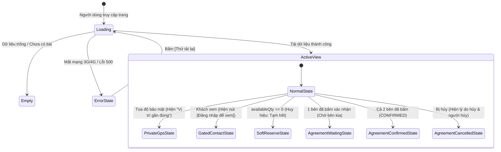

# 🔍 Báo Cáo Thẩm Định Trải Nghiệm Người Dùng (UX Review) — MEKAGREEN

> **Dự án:** MEKAGREEN — Nền tảng số kết nối nguồn cung nông sản Nam Bộ trước thu hoạch  
> **Giai đoạn:** Phase 7 (UX Review & Heuristic Evaluation)  
> **Đối tượng thẩm định:** Bản vẽ khung dây Low-fidelity Wireframes đã phê duyệt và khóa tại Giai đoạn 6 ([WIREFRAMES.md](./WIREFRAMES.md))  
> **Tài liệu nguồn chân lý (Sources of Truth):** [PROJECT_CONTEXT.md](./PROJECT_CONTEXT.md), [PRODUCT_PLAN.md](./PRODUCT_PLAN.md), [BUSINESS_RULES.md](./BUSINESS_RULES.md), [DECISIONS.md](./DECISIONS.md), [USER_FLOWS.md](./USER_FLOWS.md), [INFORMATION_ARCHITECTURE.md](./INFORMATION_ARCHITECTURE.md), [UIUX_PLANNING_PROMPT.md](./UIUX_PLANNING_PROMPT.md), [research/UIUX_REFERENCES.md](./research/UIUX_REFERENCES.md), [research/FARMING_VN_REFERENCE.md](./research/FARMING_VN_REFERENCE.md)  
> **Thời gian thẩm định:** 10/2026  
> **Trạng thái:** **ĐÃ PHÊ DUYỆT & KHÓA (APPROVED & LOCKED)** theo Quyết định chính thức của Chủ sản phẩm (Product Owner) ngày 08/10/2026. Sẵn sàng chuyển tiếp sang Giai đoạn 8 (Design System).

---

## 1. Tóm Tắt Điều Hành (Executive Summary)

Đợt thẩm định trải nghiệm người dùng (UX Review) tại **Giai đoạn 7** được tiến hành độc lập dựa trên toàn bộ 23 mẫu màn hình (Page Templates) và các luồng tương tác di động trọng yếu đã được phê duyệt và khóa tại Giai đoạn 6 ([WIREFRAMES.md](./WIREFRAMES.md)).

### 1.1. Đánh giá tổng quan
Bản vẽ khung dây Giai đoạn 6 đạt chất lượng kiến trúc thông tin và luồng thao tác rất cao, giải quyết triệt để các bài toán hóc búa của chuỗi cung ứng nông nghiệp tiền thu hoạch:
- **Tôn trọng thực tiễn giao thương nông sản:** Duy trì ranh giới rõ ràng giữa đàm phán/kết nối trên nền tảng số và thực thi giao dịch thực tế ngoài đời (giao nhận, thanh toán, kiểm hàng diễn ra ngoài hệ thống MEKAGREEN).
- **Tính minh bạch và trung thực dữ liệu:** Tách bạch tuyệt đối giữa sản lượng dự kiến và sản lượng thực thu; không ngụy tạo dữ liệu khi thiếu thông tin; không sử dụng ngôn từ pháp lý thổi phồng ("hợp đồng điện tử", "chữ ký số").
- **Cơ chế Soft Reserve & Xác nhận 2 bước (Rule 1A & 2A):** Giải quyết triệt để rủi ro bán vượt sản lượng (overcommitment) và xung đột đồng thời (race condition) mà vẫn bảo toàn tính linh hoạt cho bên mua và bên bán.
- **Quy tắc bảo mật GPS chuẩn MVP:** Bảo mật tọa độ chính xác mặc định, hiển thị vị trí gần đúng với nhãn minh bạch `"Vị trí gần đúng"`, không tự động tiết lộ sau khi chốt thỏa thuận, phù hợp hoàn hảo với tâm lý bảo vệ vườn trái cây của nông hộ Nam Bộ.

### 1.2. Các điểm nghẽn UX chính & Định hướng xử lý theo Quyết định của Chủ sản phẩm
1. **Minh bạch thỏa thuận bị hủy (`T-19`):** Khi thỏa thuận bị hủy trong trạng thái `PENDING_CONFIRMATION`, hiển thị rõ người hủy, dấu thời gian và lý do hủy (danh mục lý do bắt buộc + ghi chú tự do tùy chọn). Tuyệt đối không tạo quy trình tranh chấp/khiếu nại.
2. **Minh bạch trạng thái "Tạm hết sản lượng khả dụng" (`T-03`):** Phân biệt rõ ràng giữa *"Tạm hết sản lượng khả dụng"* (do sản lượng đang bị giữ chỗ mềm, có thể mở lại nếu thỏa thuận bị hủy) và *"Đã hết / đã chốt toàn bộ sản lượng"*. Không đưa thêm tính năng thông báo/danh sách theo dõi (watchlist).
3. **Phòng ngừa mất dữ liệu (Dirty Form Guard):** Cảnh báo xác nhận trước khi hủy/đóng biểu mẫu nếu người dùng đã nhập dữ liệu dở dang (áp dụng cho Nhật ký canh tác `T-13` và các form chính); không lạm dụng cảnh báo khi dữ liệu chưa thay đổi.
4. **Hướng dẫn khuyến nghị 15–30 ngày (`T-15`):** Duy trì dưới dạng chỉ dẫn hỗ trợ thân thiện; tuyệt đối không tạo cảm giác lỗi, cảnh báo hay ràng buộc kỹ thuật cứng.
5. **Chống bấm đúp (Double Submission Prevention):** Nút gửi đề nghị, xác nhận thỏa thuận, lưu form chuyển ngay sang trạng thái loading/disabled khi đang xử lý (yêu cầu UX, chưa viết code).
6. **Mục tiêu tiếp cận WCAG 2.1 AA:** Phase 7 xác định mục tiêu độ tương phản và đọc rõ ngoài trời; không khóa trước các mã màu Hex cụ thể. Việc kiểm chứng độ tương phản thực tế giữa chữ và nền thuộc thẩm quyền Giai đoạn 8 (Design System).
7. **Đơn vị diện tích vùng sản xuất (`T-10`):** Không áp dụng quy đổi cứng "1 ha = 10 công" do sự khác biệt khái niệm địa phương tại Nam Bộ. MVP chỉ hỗ trợ 2 đơn vị chuẩn hóa: Hecta (`ha`) và Mét vuông (`m²`) dạng `[giá trị] [ha / m²]`. Hỗ trợ đơn vị địa phương là tính năng tương lai (Nice-to-Have).
8. **Phím tắt loại hoạt động nhật ký (`T-13`):** Bổ sung hàng chip chọn nhanh loại hoạt động (`[Tưới nước]`, `[Bón phân]`, `[Phun / xử lý]`, `[Làm cỏ]`, `[Thu hoạch]`, `[Khác]`) như phím tắt giảm gõ phím trên mobile. Nông dân vẫn có thể gõ tay, viết ghi chú, tải ảnh và chọn ngày tùy ý.

---

## 2. Phương Pháp Thẩm Định (Review Method)

Quá trình thẩm định sử dụng phối hợp 4 phương pháp đánh giá chuẩn quốc tế kết hợp đặc thù bản địa:

```
+--------------------------------------------------------------------------------------------------+
|                                    KHUNG THẨM ĐỊNH UX MEKAGREEN                                   |
+------------------------------------+-----------------------------------+-------------------------+
| 1. 10 Jakob Nielsen Heuristics     | 2. Tiêu chuẩn Tiếp cận WCAG 2.1 AA| 3. Thực Địa Canh Tác    |
|    - Trạng thái trực quan          |    - Mục tiêu tương phản >= 4.5:1 |    - Nắng gắt ngoài đồng|
|    - Khớp với thực tế vụ mùa       |    - Vùng chạm bấm >= 44x44px     |    - Mạng 3G/4G chập chờn|
|    - Quyền kiểm soát & tự do hủy   |    - Nhận biết không chỉ bằng màu |    - Thao tác 1 tay     |
|    - Phòng ngừa lỗi cam kết quá mức|    - Biểu mẫu có nhãn chuẩn mực   |    - Trình độ số đa dạng|
+------------------------------------+-----------------------------------+-------------------------+
| 4. Kiểm tra Phạm vi & Ngăn chặn phình Scope: Tuyệt đối không thanh toán, không vận chuyển,        |
|    không chữ ký số, không chat thời gian thực, không bản đồ GIS phức tạp.                        |
+--------------------------------------------------------------------------------------------------+
```

---

## 3. Thẩm Định Trải Nghiệm Khách Vãng Lai & Khám Phá (Public & Guest UX Review)

*Phạm vi: Trang chủ (`T-01`), Chợ nông sản & Bản đồ (`T-02`), Chi tiết nguồn cung (`T-03`), Truy xuất nguồn gốc (`T-04`), Đăng nhập/Đăng ký (`T-05`, `T-06`).*

### 3.1. Điểm đạt chuẩn
- **Thông điệp định vị rõ ràng (Value Proposition):** Hero Banner góc rộng (Full-Bleed Panoramic) tại `T-01` truyền tải ngay mục tiêu cốt lõi: *"Kết nối nguồn cung nông sản – Chủ động trước mùa thu hoạch"*. Khách hiểu ngay đây là nền tảng đặt trước sản lượng sỉ phục vụ thương lái và nhà vườn, không phải sàn thương mại điện tử bán lẻ tiêu dùng (B2C) hay giỏ hàng Shopee.
- **Phân tách 2 CTA mạch lạc:** `[ Khám phá nguồn cung ]` (dành cho người mua/thương lái) và `[ Đăng nguồn cung ]` (dành cho nhà vườn/HTX).
- **Bộ lọc tìm kiếm gắn kết thực tế:** Cho phép lọc linh hoạt theo loại trái cây/nông sản, dải ngày dự kiến thu hoạch và đơn vị hành chính 2 cấp (Tỉnh/TP $\rightarrow$ Xã/Phường), không ép buộc dải ngày cứng 15–30 ngày.
- **Cơ chế bảo vệ thông tin liên hệ (Contact Gating):** Trên `T-03`, thông tin SĐT, liên hệ Zalo bị làm mờ nhẹ kèm nút `[🔒 Đăng nhập để xem liên hệ nhà vườn]`. Khi khách bấm vào, hệ thống dẫn tới `T-05` kèm `?returnUrl=/supply/:id`, giúp sau khi đăng nhập khách được quay lại đúng bài đăng cũ mà không bị đứt gãy mạch duyệt hàng.

### 3.2. Điểm lưu ý UX
- **Minh bạch nhãn bảo mật vị trí:** Tại chú giải bản đồ (Map Legend), duy trì thông điệp giải thích ngắn gọn, thân thiện: *"Nhằm bảo vệ an ninh và quyền riêng tư của nhà vườn, MEKAGREEN mặc định hiển thị vị trí gần đúng cấp cơ sở. Tọa độ giao nhận chính xác sẽ do hai bên trao đổi trực tiếp qua SĐT/Zalo."*

---

## 4. Thẩm Định Toàn Bộ Luồng Trải Nghiệm Nông Dân (Farmer UX Review)

*Hành trình: Tổng quan (`T-07`) $\rightarrow$ Vùng sản xuất (`T-08`/`T-10`) $\rightarrow$ Mùa vụ (`T-11`/`T-12`) $\rightarrow$ Nhật ký (`T-11`/`T-13`) $\rightarrow$ Nguồn cung (`T-14`/`T-15`) $\rightarrow$ Đề nghị thu mua (`T-16`/`T-17`) $\rightarrow$ Thỏa thuận (`T-18`/`T-19`) $\rightarrow$ Truy xuất (`T-04`).*

### 4.1. Tính tự nhiên và phụ thuộc của luồng dữ liệu
Chuỗi kế thừa dữ liệu của MEKAGREEN phản ánh chính xác chu kỳ sinh học của cây trái:
$$\text{Đất/Vườn (Vùng sản xuất)} \longrightarrow \text{Chu kỳ cây (Mùa vụ)} \longrightarrow \text{Chăm sóc (Nhật ký)} \longrightarrow \text{Sản phẩm bán (Nguồn cung)}$$

- **Khởi đầu cho Nông dân mới (First-time Onboarding):** Khi chưa có Vùng sản xuất hoặc Mùa vụ, hệ thống hiển thị màn hình hướng dẫn từng bước rõ ràng trên `T-07` thay vì trang trắng rỗng.
- **Độ phức tạp biểu mẫu & Giảm tải nhận thức:**
  - Form `T-10` (Vùng sản xuất): Đã bỏ trường bắt buộc cấp huyện theo cơ cấu hành chính 2026. Nông dân chỉ cần chọn Tỉnh $\rightarrow$ Xã $\rightarrow$ Nhập địa danh lịch sử / quen gọi (ví dụ: *Xã Mỹ Đức Tây, Tỉnh Đồng Tháp - Cái Bè cũ*).
  - Quy cách đơn vị diện tích: Hỗ trợ 2 đơn vị chuẩn hóa `(•) Hecta (ha)` hoặc `( ) Mét vuông (m²)`.
  - Cơ chế bảo vệ GPS tại `T-10`: Hộp kiểm `[x] Bảo vệ tọa độ chính xác (Mặc định bật)` giúp nhà vườn yên tâm tuyệt đối.
- **Phê duyệt đề nghị & chốt thỏa thuận:**
  - Nông dân chấp nhận đề nghị tại `T-17` (Bước 1) kích hoạt giữ chỗ mềm (`reservedQuantity`), chuyển sang `T-19` ở trạng thái `PENDING_CONFIRMATION`.
  - Nông dân độc lập kiểm tra điều khoản và bấm `[ Xác nhận thỏa thuận ]` (Bước 2) để hoàn tất.

---

## 5. Thẩm Định Luồng Trải Nghiệm Thương Lái / Bên Mua (Buyer UX Review)

*Hành trình: Chợ & Bản đồ (`T-02`) $\rightarrow$ Bộ lọc $\rightarrow$ Chi tiết nguồn cung (`T-03`) $\rightarrow$ Gọi điện/Zalo HOẶC Tạo đề nghị thu mua (`T-03` modal) $\rightarrow$ Chi tiết đề nghị (`T-17`) $\rightarrow$ Thỏa thuận thu mua (`T-19`) $\rightarrow$ Xác nhận thỏa thuận $\rightarrow$ Tra cứu QR (`T-04`).*

### 5.1. Trải nghiệm tìm kiếm & So sánh nguồn hàng
- Màn hình chia đôi (Split View) trên Desktop và thanh chuyển đổi linh hoạt (Segmented Control) trên Mobile tại `T-02` giúp thương lái vừa xem danh sách thẻ vừa bao quát cự ly địa lý gom hàng trên bản đồ nông nghiệp.
- Thẻ nguồn cung hiển thị 3 thông số then chốt mà thương lái quan tâm nhất: **Giống cây & Nông sản** | **Ngày thu hoạch & Sản lượng khả dụng** | **Địa bàn & Giá tham khảo**.

### 5.2. Phân biệt rõ: Trao đổi trực tiếp vs Gửi đề nghị trên hệ thống
- `T-03` phân tách rõ 2 hành vi:
  1. **Kênh trao đổi ngoài đời:** Nút gọi trực tiếp `[📞 Gọi số nhà vườn]` hoặc link `[ Nhắn Zalo ]` mở ứng dụng ngoài để hai bên chào hỏi, hỏi thăm tình hình vườn, hẹn ngày xem vườn.
  2. **Gửi đề nghị thu mua chính thức:** Mở Modal tạo đề nghị trên `T-03` để chốt số lượng (kg/tấn), giá đề xuất và ngày nhận hàng mong muốn.
- Giúp thương lái hiểu rõ: MEKAGREEN không giữ tiền, không trung gian thu phí, mà là công cụ xác nhận cam kết sản lượng minh bạch để tránh việc nhà vườn bán cho người khác sau khi đã nhận lời.

### 5.3. Cảnh báo pháp lý và xác nhận thỏa thuận (`T-19`)
- Cảnh báo BR-048 được trình bày trang nhã, rõ ràng: *"Thỏa thuận thu mua được hai bên xác nhận trên hệ thống MEKAGREEN. Đây không phải chữ ký số hay hợp đồng điện tử có giá trị pháp lý."* Giúp đôi bên hiểu đúng đây là biên bản ghi nhận số (Digital Confirmation Record) tạo uy tín làm ăn, không ngộ nhận là hợp đồng kinh tế công chứng.

---

## 6. Thẩm Định Luồng Quản Trị Viên (Admin UX Review)

*Phạm vi: Bảng điều khiển (`T-07`) $\rightarrow$ Người dùng (`T-21`) $\rightarrow$ Vùng sản xuất / Bài đăng (`T-22`) $\rightarrow$ Duyệt tài liệu chứng nhận (`T-23`).*

### 6.1. Kiểm soát phạm vi nghiêm ngặt (Scope Control)
- Quản trị viên MEKAGREEN được thiết kế đúng chuẩn: **Người điều hành và kiểm duyệt nội dung nền tảng (Platform Moderator)**, tuyệt đối không biến tướng thành cơ quan cấp chứng nhận pháp lý, trọng tài kinh tế, hay hệ thống ERP cồng kềnh.
- Các tác vụ khóa tài khoản, hạ bài đăng vi phạm hoặc từ chối tài liệu chứng nhận đều yêu cầu nhập lý do kiểm duyệt và có hộp thoại xác nhận thứ hai (Confirmation Modal), tránh bấm nhầm.

---

## 7. Thẩm Định Biểu Mẫu Nhập Liệu Chuyên Sâu (Form UX Review)

Đánh giá chi tiết 6 biểu mẫu nghiệp vụ cốt lõi của hệ thống:

| Biểu mẫu | Mục đích | Số trường bắt buộc / tùy chọn | Đánh giá độ phức tạp & Tải nhận thức | Quyết định chuẩn hóa UX đã duyệt |
|:---|:---|:---:|:---|:---|
| **Form Vùng sản xuất (`T-10`)** | Khởi tạo vườn trồng | 4 bắt buộc / 2 tùy chọn | **Vừa phải.** Bố cục 2 cột Desktop / 1 cột Mobile rõ nét. Nhập diện tích thủ công, chọn điểm GPS trực quan. | Hỗ trợ 2 đơn vị chuẩn hóa: `[ Giá trị ] [ (•) Hecta (ha) | ( ) Mét vuông (m²) ]`. Không áp dụng quy đổi cứng đơn vị "công". |
| **Form Mùa vụ (`T-12`)** | Khởi tạo vụ canh tác | 3 bắt buộc / 1 tùy chọn | **Rất nhẹ.** Tự động gắn kết với Vùng sản xuất đã chọn. Chỉ cần chọn loại cây, tên giống, khoảng thời gian dự kiến. | Trường tên giống có gợi ý tự động (Autocomplete) các giống Nam Bộ phổ biến: Ri6, Monthong, Cát Hòa Lộc, Da xanh. |
| **Form Ghi nhật ký (`T-13`)** | Ghi chép tại vườn | 2 bắt buộc / 2 tùy chọn | **Tối ưu Mobile.** Thiết kế dạng Drawer trượt đáy. Ưu tiên nút chụp ảnh thực tế tại vườn. | Bổ sung phím tắt chip chọn nhanh: `[Tưới nước]`, `[Bón phân]`, `[Phun / xử lý]`, `[Làm cỏ]`, `[Thu hoạch]`, `[Khác]`. Vẫn hỗ trợ gõ tay, ghi chú, đính ảnh, chọn ngày. |
| **Form Đăng nguồn cung (`T-15`)** | Đăng bán trước thu hoạch | 4 bắt buộc / 1 tùy chọn | **Vừa phải.** Kế thừa thông tin mùa vụ. Nhập sản lượng dự kiến, ngày thu hoạch, giá tham khảo. | Hộp khuyến nghị 15–30 ngày hiển thị dạng gợi ý màu xanh thân thiện (Guide Box), tuyệt đối không hiển thị màu đỏ/vàng gây cảm giác là lỗi/cảnh báo. |
| **Modal Gửi đề nghị (`T-03`)** | Thương lái gửi báo giá | 3 bắt buộc / 1 tùy chọn | **Gọn gàng.** Hiển thị thẻ tóm tắt nguồn cung ngay trên đầu form. | Giới hạn trường số lượng đề xuất: `max = availableQuantity`. Chống bấm đúp bằng trạng thái loading/disabled tức thì. |
| **Xác nhận thỏa thuận (`T-19`)** | Chốt thỏa thuận 2 bên | 0 trường nhập (chỉ bấm nút) | **Cực kỳ trực quan.** Đọc snapshot điều khoản đóng băng $\rightarrow$ Bấm 1 nút xác nhận. | Khi hủy thỏa thuận chưa chốt: Mở Modal yêu cầu chọn lý do bắt buộc từ danh mục + ghi chú tự do tùy chọn để lưu vết minh bạch. |

---

## 8. Thẩm Định Tương Tác Bản Đồ & Danh Sách (Map UX Review)

### 8.1. Tuân thủ định dạng bản đồ MVP
Bản đồ MEKAGREEN tuân thủ nghiêm ngặt nguyên tắc MVP đã phê duyệt tại [DECISIONS.md](./DECISIONS.md) (ADR-006 & ADR-009):
- **Chỉ dùng điểm ghim (Point marker only):** Kinh độ, vĩ độ đơn lẻ. Tuyệt đối không vẽ đa giác (polygon), không tính toán diện tích bằng bản đồ, không cài đặt cơ sở dữ liệu không gian phức tạp (No PostGIS / MySQL Spatial).
- **Mặc định bảo vệ tọa độ:** Bản đồ công khai hiển thị điểm ghim đại diện địa bàn cấp xã kèm nhãn `"Vị trí gần đúng"`.
- **Nếu thiếu tọa độ GPS:** Không bao giờ tự bịa điểm ghim ảo; hiển thị thông tin địa chỉ hành chính dạng text kèm ghi chú rõ.

### 8.2. Tính đồng bộ giữa Bản đồ và Danh sách (Dual-Pane Sync)
- **Trên Desktop (`T-02`):** Cột danh sách (50%) và Khung bản đồ Leaflet (50%) sử dụng chung 1 bộ lọc và 1 tập kết quả tìm kiếm. Khi nhấp vào thẻ ở danh sách, điểm ghim tương ứng trên bản đồ nổi bật. Ngược lại, khi nhấp vào ghim trên bản đồ, danh sách tự động cuộn tới bài đăng tương ứng.
- **Trên Mobile (`T-02`):** Sử dụng thanh chuyển đổi `[• Danh sách (24) | Bản đồ (24)]`. Khi ở chế độ bản đồ, nhấp vào điểm ghim sẽ mở tấm trượt từ đáy (Bottom Sheet) hiển thị thẻ tóm tắt với đầy đủ thanh sản lượng và nút `[ Mở xem chi tiết bài đăng ]`.

---

## 9. Thẩm Định Trải Nghiệm Thiết Bị Di Động (Mobile Usability Audit)

MEKAGREEN được thiết kế với tư duy **Mobile-First cho Nông dân** và tối ưu thực địa Nam Bộ:

```
+--------------------------------------------------------------------------------------------------+
|                            ĐÁNH GIÁ CÔNG THÁI HỌC DI ĐỘNG (MOBILE ERGONOMICS)                    |
+------------------------------------+-----------------------------------+-------------------------+
| Tiêu chí kỹ thuật                  | Hiện trạng khung dây MEKAGREEN    | Kết luận đánh giá       |
+------------------------------------+-----------------------------------+-------------------------+
| Chiều rộng tương thích 320px-430px | Bố cục co giãn 1 cột, không tràn ngang, viền lề 16px.       | ✅ Đạt chuẩn hoàn hảo   |
| Vùng bấm ngón cái (Thumb Zone)     | Các nút hành động chính (CTA) đặt ở nửa dưới màn hình.      | ✅ Thao tác 1 tay tốt   |
| Thanh tác vụ đáy ghim (Sticky Bar) | `T-03`, `T-17`, `T-19` có thanh đáy ghim cố định với bóng đổ| ✅ Dễ thấy, không bị che|
| Kích thước vùng chạm >= 44x44px    | Chiều cao nút bấm, ô input đều đạt 48px, cách nhau >= 12px. | ✅ Đạt chuẩn WCAG       |
| Tránh nhảy màn hình khi gõ chữ     | Ô nhập cỡ chữ 16px, ngăn chặn iOS Safari tự phóng to 120%.  | ✅ Tối ưu biểu mẫu      |
+------------------------------------+-----------------------------------+-------------------------+
```

- **Kiến trúc điều hướng đồng nhất:** Đã loại bỏ hoàn toàn thanh bottom bar tự phát không có trong IA. Toàn bộ điều hướng mobile sử dụng Top Header chuẩn với Menu Drawer trượt ngang `[=]`, đồng nhất cho mọi vai trò.
- **Phòng ngừa thoát form bất cẩn (Dirty Form Guard):** Drawer ghi nhật ký `T-13` và các form tạo dữ liệu hiển thị cảnh báo xác nhận trước khi hủy nếu người dùng đã nhập nội dung dở dang. Không hiện cảnh báo nếu form chưa có thay đổi.
- **Khả năng hiển thị tên địa danh tiếng Việt dài:** Các cụm từ hành chính 2026 (ví dụ: *Xã Mỹ Đức Tây, Tỉnh Đồng Tháp / Cái Bè cũ*) được quy định xuống dòng tự nhiên, không dùng kỹ thuật cắt cụt chữ (`text-overflow: ellipsis`) làm mất thông tin địa chỉ quan trọng.

---

## 10. Thẩm Định Độ Phủ Trạng Thái & Xử Lý Lỗi (State & Error Review)

Hệ thống bảo đảm độ phủ toàn diện 14 trạng thái giao diện cốt lõi mà không làm phát sinh thêm các route trang mới:



1. **Trạng thái Đang tải (Loading):** Sử dụng khung xương mờ (Skeleton Screens) mô phỏng chính xác khung thẻ bài đăng, loại bỏ tình trạng giật cục (layout shift).
2. **Trạng thái Trống (Empty):** Mỗi bảng danh sách khi chưa có dữ liệu đều có hình minh họa nhẹ nhàng, lời giải thích và nút tạo mới rõ ràng.
3. **Trạng thái Lỗi mạng / Mất kết nối (Offline/Error):** Hiển thị khối thông báo thân thiện kèm nút bấm lớn `[ 🔄 Thử tải lại ]`.
4. **Trạng thái Không tìm thấy kết quả lọc (No Results):** Hiển thị gợi ý mở rộng khoảng ngày thu hoạch hoặc chọn tất cả địa bàn kèm nút `[ Xóa bộ lọc ]`.
5. **Trạng thái Thiếu ảnh (Missing Image):** Sử dụng ảnh minh họa vector cây trái miệt vườn Nam Bộ, tuyệt đối không để icon ảnh vỡ `broken image`.
6. **Trạng thái Bảo vệ GPS:** Hiển thị điểm ghim cấp xã kèm nhãn rõ ràng `"Vị trí gần đúng"`.
7. **Trạng thái Chưa đăng nhập (Gated Contact):** Khối SĐT/Zalo hiển thị nút `[ 🔒 Đăng nhập tài khoản để xem liên hệ nhà vườn ]`.
8. **Trạng thái Bài đăng đã đóng / đã hủy (`CLOSED` / `CANCELLED`):** Khóa toàn bộ nút gửi đề nghị, hiển thị huy hiệu xám rõ ràng.
9. **Trạng thái Hết sản lượng do giữ chỗ (Soft Reserve UX State):** Phân biệt rành mạch *"Tạm hết sản lượng khả dụng (Chờ xác nhận)"* với *"Đã hết / đã chốt toàn bộ sản lượng"*; giải thích rõ sản lượng có thể mở lại nếu thỏa thuận giữ chỗ bị hủy.
10. **Trạng thái Đề nghị đang chờ (`PENDING`):** Hiển thị nút rút đề nghị cho Buyer, nút chấp nhận/từ chối cho Farmer.
11. **Trạng thái Đề nghị bị từ chối / đã rút (`REJECTED` / `WITHDRAWN`):** Trạng thái kết thúc tĩnh, ghi nhận thời gian.
12. **Trạng thái Thỏa thuận chờ bên kia xác nhận:** Nút của người đã xác nhận chuyển thành huy hiệu tích xanh tĩnh kèm dấu thời gian: `[ ✅ Bạn đã xác nhận. Đang chờ đối tác... ]`.
13. **Trạng thái Thỏa thuận hoàn tất (`CONFIRMED`):** Khóa bất biến. Ẩn toàn bộ nút hủy và nút xác nhận. Hiện nút `[ 📄 Xuất biên bản PDF (Tùy chọn) ]`.
14. **Trạng thái Thỏa thuận bị hủy (`CANCELLED`):** Khối thông báo đầu trang hiển thị rõ ai là người hủy, thời điểm hủy và lý do hủy cụ thể (danh mục lý do bắt buộc + ghi chú tự do tùy chọn).

---

## 11. Thẩm Định Rủi Ro Khả Năng Tiếp Cận (Accessibility Goals - WCAG 2.1 AA)

*Lưu ý: Phase 7 xác định các **mục tiêu tiếp cận định lượng**, không khóa trước các mã màu Hex cụ thể. Việc kiểm chứng độ tương phản thực tế giữa chữ và nền (Actual Foreground/Background Contrast) sẽ được thực hiện chính thức tại Giai đoạn 8 (Design System).*

| Tiêu chuẩn WCAG 2.1 AA | Mục tiêu tiếp cận (Accessibility Goals) | Nguy cơ thực địa Nam Bộ | Định hướng thực hiện tại Giai đoạn 8 |
|:---|:---|:---|:---|
| **1.4.3 Contrast (Minimum)** | Độ tương phản văn bản chữ/nền $\ge 4.5:1$ (chữ thường), $\ge 3:1$ (chữ lớn) | Nắng gắt làm lóa màn hình ngoài vườn; chữ xám nhạt sẽ biến mất hoàn toàn | Lựa chọn các cặp màu văn bản/nền có độ tương phản thực tế cao, kiểm chứng bằng công cụ đo WCAG. |
| **1.4.11 Non-text Contrast** | Viền nút bấm, ô nhập, thanh tiến độ $\ge 3:1$ so với nền | Phân đoạn giữ chỗ hoặc viền ô nhập bị mờ nhạt ngoài trời nắng | Thiết lập viền rõ nét và phân đoạn thanh tiến độ có độ chênh màu rõ rệt so với nền. |
| **2.5.5 Target Size** | Vùng chạm tối thiểu $44 \times 44\text{px}$ trên di động | Tay nông dân dính đất/ướt dễ bấm trượt nếu các nút quá sát nhau | Quy chuẩn chiều cao nút bấm và ô chọn tối thiểu $48\text{px}$, khoảng cách biên tối thiểu $12\text{px}$. |
| **1.4.1 Use of Color** | Không truyền tải trạng thái chỉ bằng màu sắc đơn thuần | Người khiếm thị màu đỏ-xanh không phân biệt được Đã cam kết vs Còn khả dụng | Tất cả trạng thái đều bắt buộc có **Icon đại diện + Nhãn chữ tiếng Việt đi kèm**. |
| **3.3.2 Labels or Instructions** | Luôn có nhãn cố định phía trên ô nhập liệu | Dùng placeholder thay label làm nông dân quên trường khi đang gõ | Bắt buộc hiển thị `<label>` cố định phía trên ô nhập kèm dấu sao đỏ `(*)`. |

---

## 12. Kiểm Soát Phạm Vi & Ngăn Ngừa Phình Tính Năng (Scope Creep Guard)

Báo cáo xác nhận toàn bộ bản vẽ khung dây Giai đoạn 6 **hoàn toàn sạch bóng các tính năng ngoài phạm vi MVP**. Tuyệt đối không xuất hiện:
- ❌ **Không cổng thanh toán, đặt cọc hay giữ tiền ký quỹ (No Payment / Escrow).**
- ❌ **Không tính toán cước vận chuyển, điều xe hay tích hợp đơn vị giao hàng (No Logistics).**
- ❌ **Không hóa đơn điện tử, xuất hóa đơn VAT (No Invoicing).**
- ❌ **Không chat thời gian thực socket trên web (No Realtime Chat - liên hệ thuần túy qua SĐT/Zalo ngoài đời).**
- ❌ **Không thuật toán AI ghép đôi hay sàn đấu giá tài chính phức tạp.**
- ❌ **Không chữ ký số PKI, USB token hay tuyên bố hợp đồng có giá trị pháp lý nhà nước.**
- ❌ **Không bản đồ vẽ polygon ranh giới thửa đất hay tính toán diện tích bằng GIS.**
- ❌ **Không quy trình trọng tài xử lý tranh chấp bồi thường.**

---

## 13. Danh Mục Vấn Đề UX Đã Phê Duyệt (Approved UX Decisions Matrix)

| Mã | Màn hình | Vấn đề phát hiện | Quyết định phê duyệt của Chủ sản phẩm |
|:---|:---|:---|:---|
| **ISS-01** | `T-19` | Minh bạch thỏa thuận bị hủy (`CANCELLED`) | **ĐÃ PHÊ DUYỆT.** Hiển thị rõ: người hủy, dấu thời gian, lý do hủy (kết hợp danh mục lý do bắt buộc + ghi chú tự do tùy chọn). Không tạo luồng tranh chấp. |
| **ISS-02** | `T-03` | Minh bạch trạng thái "Tạm hết sản lượng khả dụng" | **ĐÃ PHÊ DUYỆT.** Phân biệt rõ ràng với "Đã chốt hết"; giải thích có thể mở lại nếu giải phóng cam kết. Không làm watchlist/notification. |
| **ISS-03** | `T-13` | Nguy cơ mất dữ liệu khi thoát Drawer ghi nhật ký | **ĐÃ PHÊ DUYỆT.** Bổ sung cảnh báo trước khi thoát nếu form có dữ liệu chưa lưu (Dirty Form Guard). Không lạm dụng khi chưa có thay đổi. |
| **ISS-04** | `T-10` | Quy chuẩn đơn vị diện tích vườn | **ĐÃ PHÊ DUYỆT.** Không làm quy đổi cứng "1 ha = 10 công". MVP chỉ hỗ trợ 2 đơn vị chuẩn: Hecta (`ha`) và Mét vuông (`m²`). Hỗ trợ đơn vị địa phương là Future. |
| **ISS-05** | `T-15` | Trình bày gợi ý 15–30 ngày thu hoạch | **ĐÃ PHÊ DUYỆT.** Duy trì dưới dạng chỉ dẫn hỗ trợ thân thiện; không hiển thị như lỗi, cảnh báo hay ràng buộc cứng. |
| **ISS-06** | `T-02` | Chuyển đổi linh hoạt giữa Bản đồ và Danh sách mobile | **ĐÃ PHÊ DUYỆT.** Giữ Segmented Control và phím chuyển đổi chế độ dễ bấm trong tầm với ngón cái. |

---

## 14. Đề Xuất Các Hiệu Chỉnh Kỹ Thuật Giao Diện (UI Implementation Guidance)

1. **Chống bấm đúp (Double Submission Prevention):** Mọi nút bấm tác vụ quan trọng (`[Gửi đề nghị]`, `[Xác nhận thỏa thuận]`, `[Lưu nhật ký]`) lập tức chuyển sang trạng thái Loading (Spinner xoay + Disabled) ngay khi bấm (yêu cầu UX, chưa viết mã).
2. **Quy chuẩn độ tương phản thực tế:** Chuyển giao việc chọn bảng màu cụ thể sang Giai đoạn 8 (Design System) để đo lường độ tương phản thực tế theo tiêu chuẩn WCAG 2.1 AA.
3. **Hiển thị nhãn trạng thái đồng nhất:** Chuẩn hóa các bộ nhãn trạng thái tiếng Việt duy nhất, không dùng từ đồng nghĩa lẫn lộn giữa danh sách và trang chi tiết.

---

## 15. Quyết Định Phê Duyệt Chính Thức Của Chủ Sản Phẩm (Product Owner Approved Decisions)

Chủ sản phẩm (Product Owner) đã chính thức phê duyệt Báo cáo UX Review với 8 quyết định cụ thể sau:

1. **ISS-01 — Thỏa thuận bị hủy (`T-19`):** Chấp thuận hiển thị người hủy, thời điểm hủy, lý do hủy (chọn lý do bắt buộc + ghi chú tự do tùy chọn). Không tạo luồng khiếu nại/tranh chấp.
2. **ISS-02 — Tạm hết sản lượng khả dụng:** Chấp thuận phân biệt rõ với đã chốt hết 100%; giải thích khả năng mở lại sản lượng. Không làm notification/watchlist.
3. **Dirty Form Guard:** Chấp thuận cảnh báo mất dữ liệu chưa lưu trên `T-13` và các form chính. Không lạm dụng khi form chưa thay đổi.
4. **Hướng dẫn 15–30 ngày:** Chấp thuận giữ nguyên tính chất chỉ dẫn hỗ trợ, không hiển thị như lỗi hay cảnh báo.
5. **Chống gửi trùng lặp (Double Submission):** Chấp thuận yêu cầu chuyển nút sang loading/disabled ngay khi bấm.
6. **Màu sắc và độ tương phản:** Không khóa mã Hex trong Phase 7. Việc kiểm chứng độ tương phản thực tế thuộc Giai đoạn 8 (Design System).
7. **Đơn vị diện tích vùng sản xuất:** Không áp dụng quy đổi "1 ha = 10 công". MVP hỗ trợ chuẩn hóa Hecta (`ha`) và Mét vuông (`m²`) dạng `[giá trị] [ha / m²]`. Đơn vị địa phương là Future / Nice-to-Have.
8. **Phím tắt loại hoạt động nhật ký (`T-13`):** Chấp thuận bổ sung hàng chip chọn nhanh (`[Tưới nước]`, `[Bón phân]`, `[Phun / xử lý]`, `[Làm cỏ]`, `[Thu hoạch]`, `[Khác]`) làm phím tắt giảm gõ phím trên mobile; vẫn hỗ trợ đầy đủ các phương thức nhập liệu khác.

---

## 16. Kết Luận & Khóa Giai Đoạn 7 (Phase 7 Lock & Transition)

### Kết luận
Toàn bộ hệ thống khung dây Low-fidelity Wireframes của MEKAGREEN đã vượt qua đợt thẩm định trải nghiệm người dùng toàn diện, tuân thủ nghiêm ngặt phạm vi MVP 2 tháng và đã nhận được đầy đủ các quyết định phê duyệt chính thức từ Chủ sản phẩm.

### Khóa Giai đoạn
- **PHASE 7 — UX REVIEW: ĐÃ PHÊ DUYỆT & KHÓA (APPROVED & LOCKED).**
- Giai đoạn tiếp theo được phép triển khai: **PHASE 8 — HỆ THỐNG THIẾT KẾ (DESIGN SYSTEM)**.
- *Quy tắc an toàn: Không bắt đầu Giai đoạn 8 cho đến khi có yêu cầu thực thi cụ thể.*

---
> _Báo cáo UX Review chính thức — Đã phê duyệt và khóa ngày 08/10/2026_
